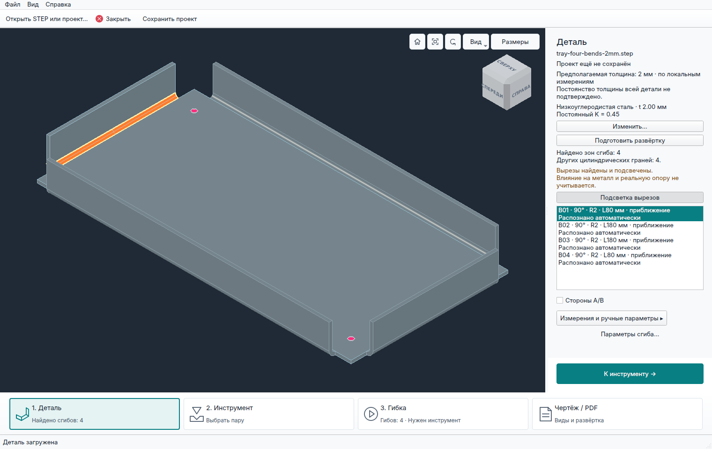
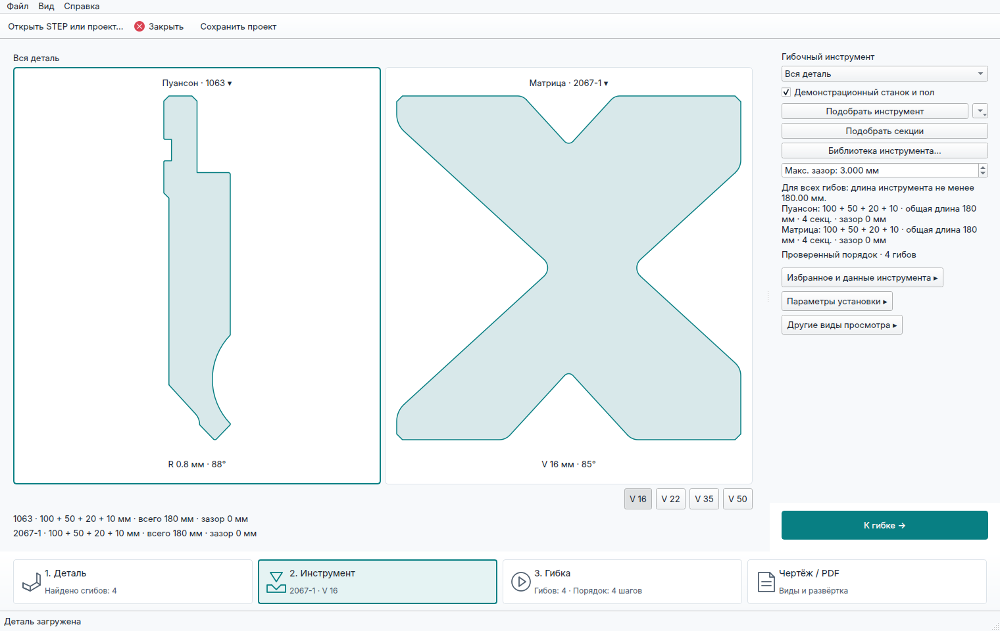
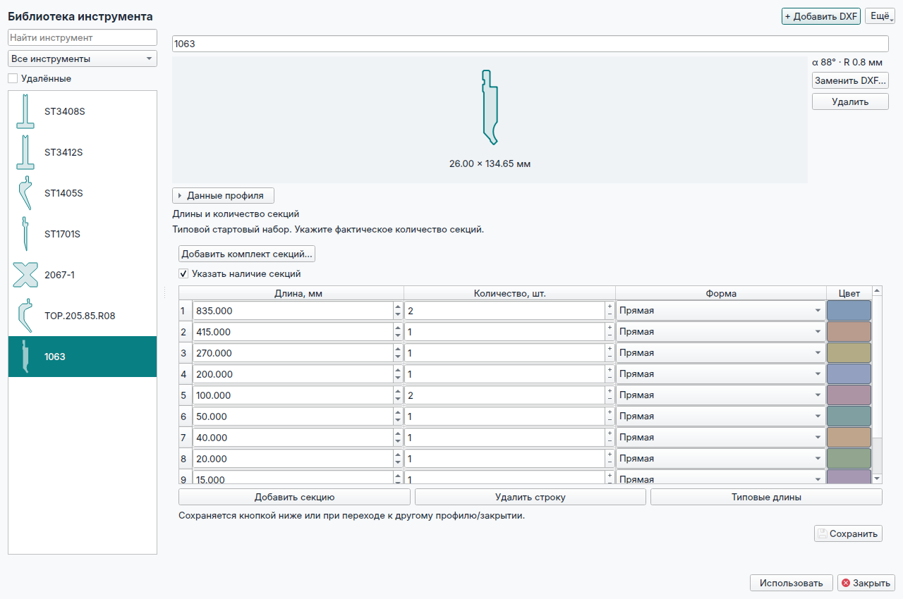
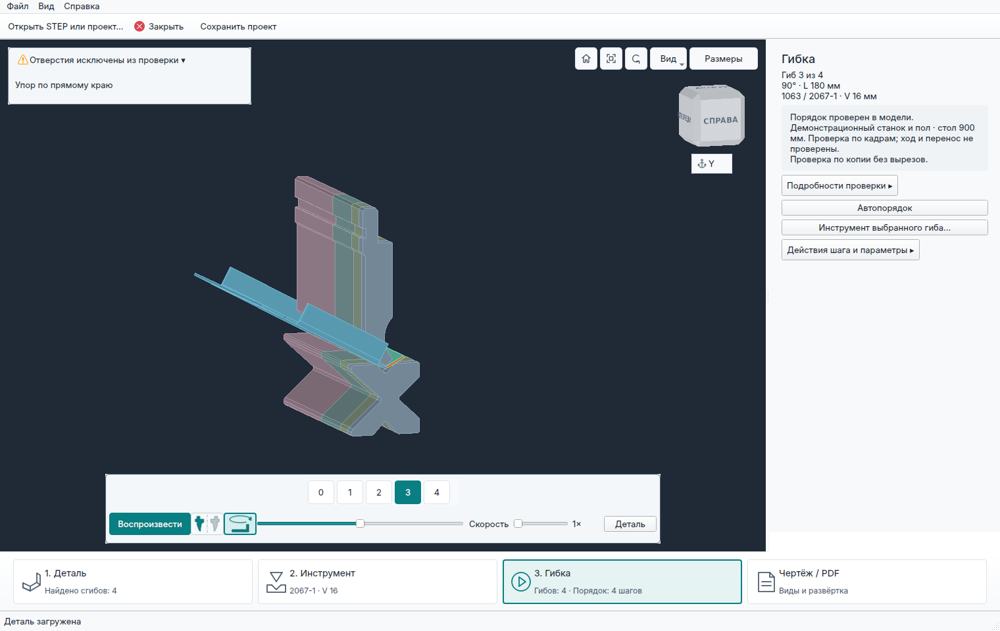
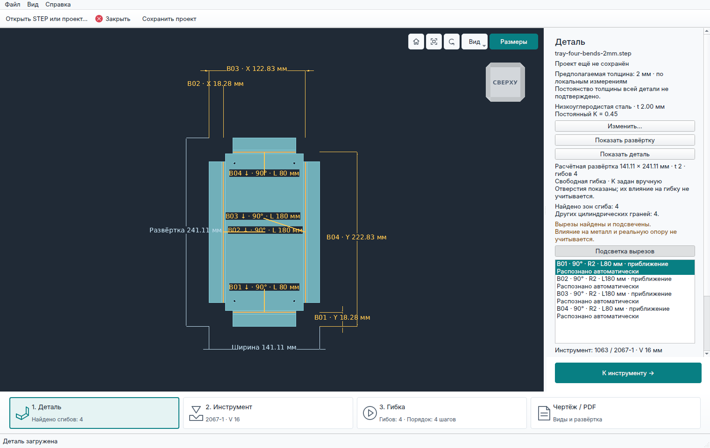
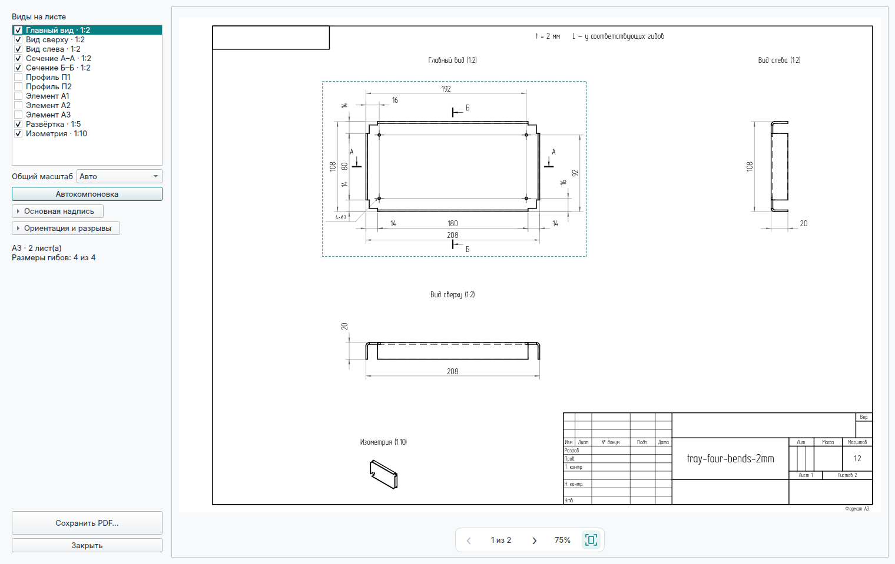
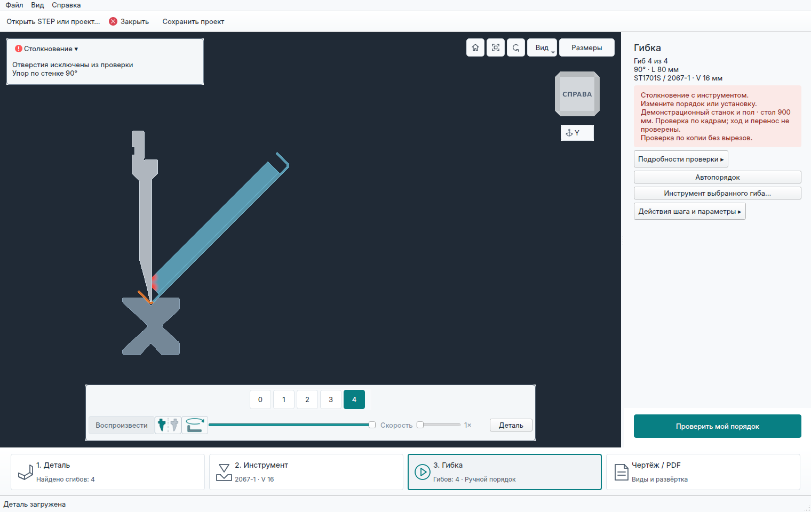

# 3D Bending Simulator

[Русский](README.md) | **English**

An application for preliminary geometric checks of sheet metal bending based on a STEP model of the finished part.

Helps manufacturing engineers choose available tooling, check the bend sequence, and identify potential collisions before production.

The project is in **alpha**. Prebuilt releases are available for **Windows x64**.

## Features

- STEP import, thickness detection for supported parts, and `.bend` project files.
- A punch and die library based on DXF profiles, with segment lengths and quantities. A starter set of profiles is included.
- Tooling and bend sequence selection, with manual selection and reordering of operations.
- Step-by-step 3D playback with collision highlighting for the part, tooling, demonstration press brake, and backgauge.
- A theoretical flat pattern and a reference drawing with dimensions and PDF export.

## Download and run

1. Download the Windows ZIP from the [releases page](https://github.com/DenisPapushaJava/3d-bending-simulator/releases).
2. Extract the entire archive, preserving its folder structure.
3. Run `3d-bending-simulator.exe` from the package root.

If the MSVC runtime libraries are missing, install the [Microsoft Visual C++ x64 Runtime](https://learn.microsoft.com/en-us/cpp/windows/latest-supported-vc-redist).

Sample STEP models are included in the package. See the [examples directory](examples/README.md) for descriptions.

## Basic workflow

1. **Part (Деталь):** open a STEP file, select the material, and check the thickness.
2. **Tooling (Инструмент):** select a punch and die, specify the available segments, or use automatic selection.
3. **Bending (Гибка):** find a bend sequence or arrange it manually, run the checks, and review the operations.
4. **Drawing / PDF (Чертёж / PDF):** prepare a reference sheet for the finished part and, where the geometry is supported, a theoretical flat pattern.

A `.bend` project stores the source model and parameters so you can resume your work.

## Example workflow

The [four-bend box, 2 mm sheet](examples/tray-four-bends-2mm.step), using [real DXF profiles from the starter library](docs/starter-tool-library.md). Screenshots show the Russian interface.

| Part and bend recognition | Tooling selection |
| :---: | :---: |
|  |  |
| **Profile and segment library** | **Bending — work area** |
|  |  |
| **Theoretical flat pattern** | **Drawing and PDF** |
|  |  |

**Collision checking.** Collisions are highlighted in red and stop playback. This example shows the box colliding with the ST1701S punch during the fourth bend.

## Current limitations

- Constant-thickness parts with straight bends are supported within the implemented geometric model.
- The press brake and backgauge are simplified demonstration models.
- Motion checks have limited coverage. Part removal and transfer between setups are not checked.
- Bending force, springback, and physical deformation of holes are not calculated. Some checks use a separate copy with enclosed cutouts filled in.
- Flat patterns are theoretical and are not calibrated against test bends. Flat-pattern DXF export and CNC program generation are not yet available.

The result is a preliminary geometric assessment. A specialist makes the final manufacturing decision, taking the equipment, tooling, and material into account.

## Development and documentation

The application is written in **C++20** and uses **Qt 6 Widgets**, **Open CASCADE 7.x**, and **CMake**. Development and testing also take place on Linux.

Detailed documentation is currently in Russian.

- [Building and testing](docs/development.md)
- [STEP import](docs/step-import.md)
- [Tool library](docs/dxf-only-tool-library.md)
- [Bend sequences and check coverage](docs/bend-route.md)
- [Theoretical flat pattern](docs/flat-pattern.md)
- [Drawing and PDF](docs/bending-drawing.md)
- [Changelog](CHANGELOG.md)

## License

The project's own code is licensed under [MIT](LICENSE).
Third-party licenses and notices are listed in [THIRD_PARTY_NOTICES.md](THIRD_PARTY_NOTICES.md).
