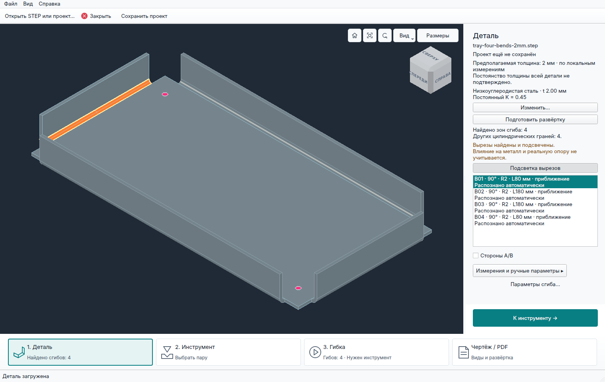
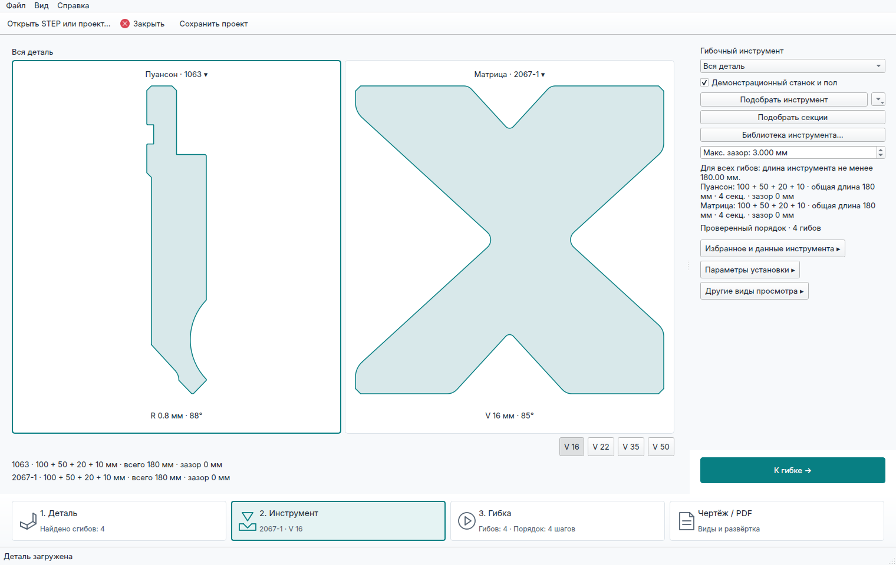
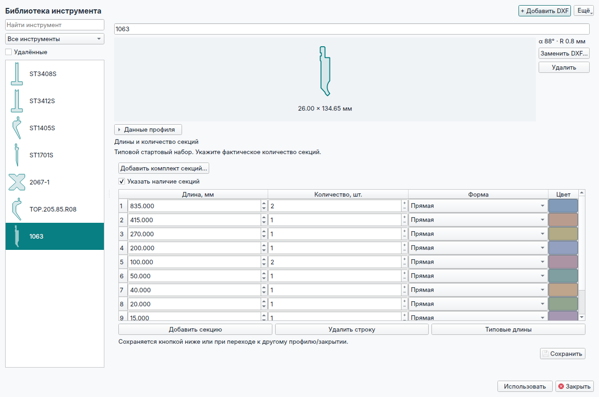
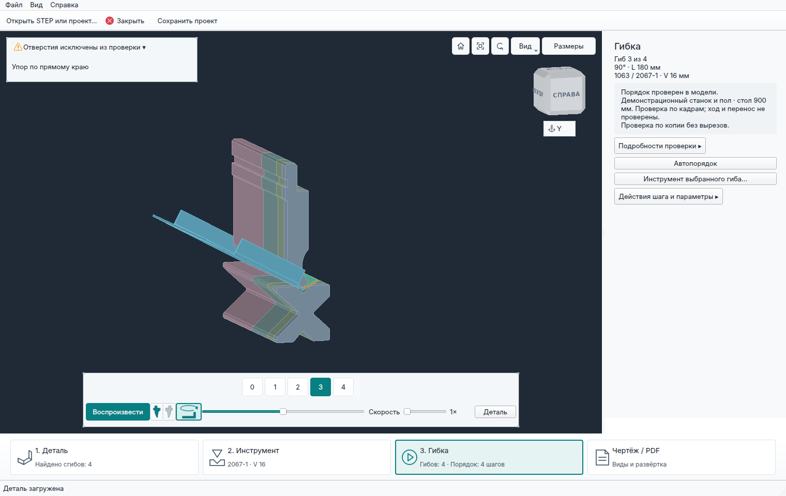
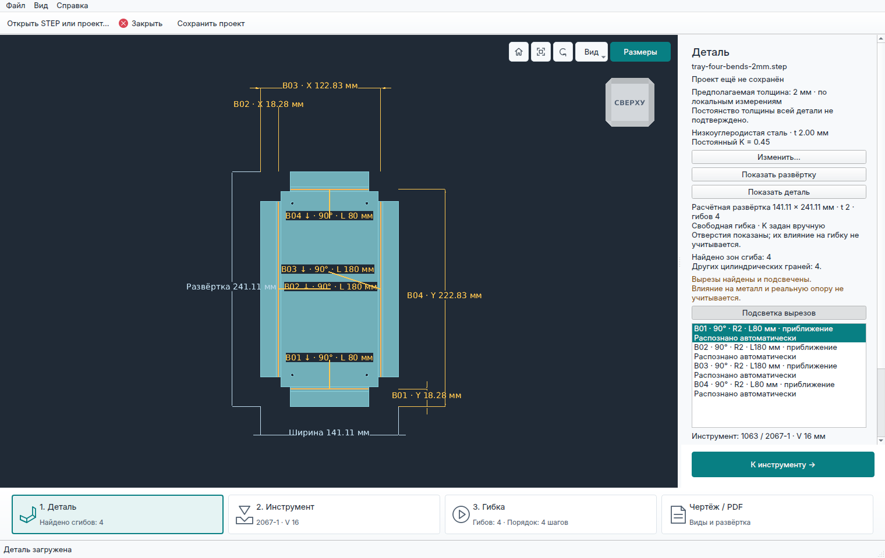
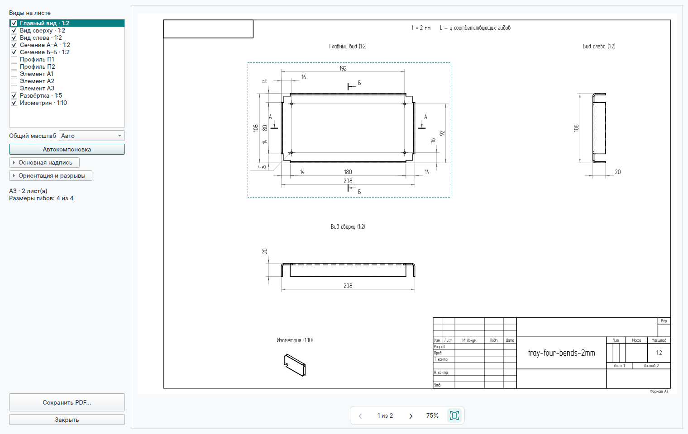
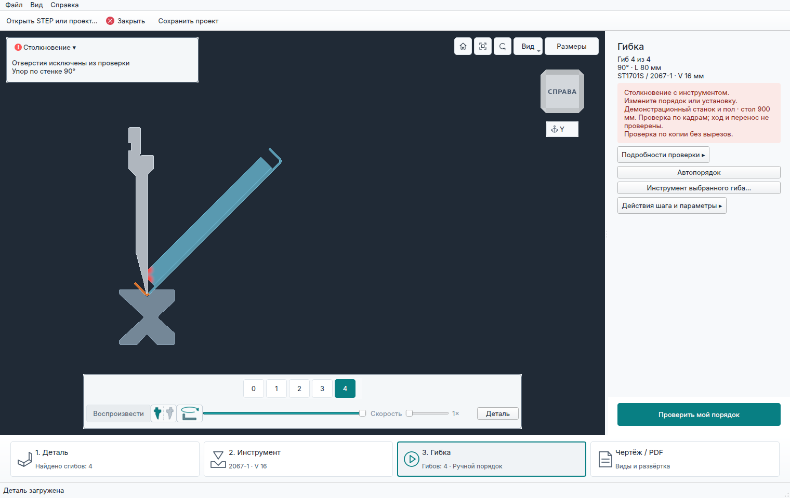

# 3D Bending Simulator

**Русский** | [English](README.en.md)

Программа для предварительной геометрической проверки листовой гибки по STEP-модели готовой детали.

Помогает технологу выбрать доступный инструмент, проверить порядок гибов и увидеть возможные столкновения до начала изготовления.

Проект находится в стадии **alpha**. Готовые сборки предназначены для **Windows x64**.

## Возможности

- Загрузка STEP, определение толщины поддерживаемых деталей и сохранение проектов `.bend`.
- Библиотека пуансонов и матриц из DXF с учётом длин секций и их количества. В комплект входит стартовый набор профилей.
- Подбор инструмента и порядка гибов, ручной выбор и перестановка операций.
- Пошаговый 3D-просмотр с подсветкой столкновений детали, инструмента, демонстрационного станка и упоров.
- Теоретическая развёртка и справочный чертёж с размерами и экспортом в PDF.

## Скачать и запустить

1. Скачайте Windows ZIP со [страницы релизов](https://github.com/DenisPapushaJava/3d-bending-simulator/releases).
2. Полностью распакуйте архив, сохранив структуру папок.
3. Запустите `3d-bending-simulator.exe` из корня комплекта.

При отсутствии библиотек MSVC установите [Microsoft Visual C++ x64 Runtime](https://learn.microsoft.com/en-us/cpp/windows/latest-supported-vc-redist).

Учебные STEP-модели входят в комплект. Их описание — в [папке примеров](examples/README.md).

## Основной сценарий

1. **Деталь:** откройте STEP, выберите материал и проверьте толщину.
2. **Инструмент:** выберите пуансон и матрицу, задайте доступные секции или воспользуйтесь подбором.
3. **Гибка:** подберите порядок либо составьте его вручную, запустите проверку и просмотрите операции.
4. **Чертёж / PDF:** подготовьте справочный лист готовой детали и, при поддерживаемой геометрии, теоретическую развёртку.

Проект `.bend` сохраняет исходную модель и параметры для продолжения работы.

## Пример работы

[Коробочка с четырьмя гибами, t2](examples/tray-four-bends-2mm.step) и [реальные DXF-профили из стартовой библиотеки](docs/starter-tool-library.md).

| Деталь и распознавание гибов | Выбор инструмента |
| :---: | :---: |
|  |  |
| **Библиотека профилей и секций** | **Гибка — рабочая зона** |
|  |  |
| **Теоретическая развёртка** | **Чертёж и PDF** |
|  |  |

**Проверка столкновений.** Конфликтные участки подсвечиваются красным, воспроизведение останавливается. Здесь — столкновение коробочки с пуансоном ST1701S на четвёртом гибе.

## Текущие ограничения

- Поддерживаются детали постоянной толщины с прямыми гибами в пределах реализованной геометрической модели.
- Станок и задние упоры представлены упрощёнными демонстрационными моделями.
- Проверки движения имеют ограниченный охват. Извлечение и перенос детали между установками не проверяются.
- Усилие, пружинение и физическая деформация отверстий не рассчитываются. В части проверок используется отдельная копия с заполненными замкнутыми вырезами.
- Развёртка рассчитывается теоретически, без калибровки по пробным гибам. Экспорт развёртки в DXF и формирование программы ЧПУ пока отсутствуют.

Результат служит предварительной геометрической оценкой. Окончательное решение об изготовлении принимает специалист с учётом оборудования, инструмента и материала.

## Разработка и документация

Приложение написано на **C++20**, использует **Qt 6 Widgets**, **Open CASCADE 7.x** и **CMake**. Разработка и проверки также ведутся на Linux.

- [Сборка и тестирование](docs/development.md)
- [Импорт STEP](docs/step-import.md)
- [Библиотека инструмента](docs/dxf-only-tool-library.md)
- [Порядок гибов и границы проверок](docs/bend-route.md)
- [Теоретическая развёртка](docs/flat-pattern.md)
- [Чертёж и PDF](docs/bending-drawing.md)
- [История изменений](CHANGELOG.md)

## Лицензия

Собственный код — [MIT](LICENSE).
Лицензии и уведомления сторонних компонентов — в [THIRD_PARTY_NOTICES.md](THIRD_PARTY_NOTICES.md).
