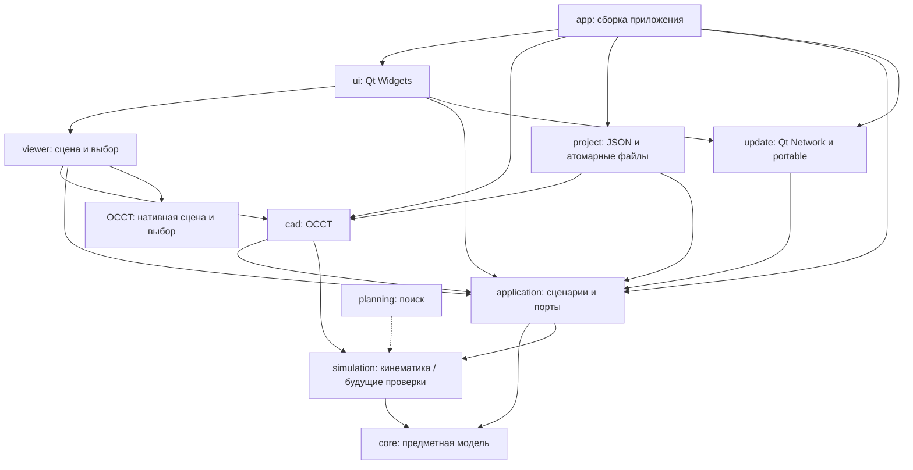

# Архитектура 3D Bending Simulator

D128: `ToolLibrary` атомарно инициализирует только отсутствующее хранилище переданным из composition root стартовым DXF-снимком. Встроенный ресурс читает `project`; исходный набор отделён от пользовательской копии и наличия. Признак exists принадлежит порту, шаблоны секций привязаны к точной геометрии. Форматы/подбор/назначения прежние. [Контракт](starter-tool-library.md).

D126: CAD публикует типизированный отчёт нехватки длины активной операции; контроллер сверяет его с входами. UI собирает текущие `BendMessage`, пассивный `BendMessagePanel` показывает важность/подробности; viewer позиционирует верхнюю Qt-панель без SDK-вычислений. Ручной/полный путь используют общий предикат осевой длины, охват проверки не меняется. [Контракт](bend-messages.md).

D127: обычный транспорт при нехватке длины заблокирован. Временное разрешение диагностического просмотра принадлежит UI и связано weak_ptr с текущим принятым `RouteDraft`; новая установка/шаг/этап его снимает. Оно не передаётся расчёту, проекту или кэшу и не отключает остановку коллизий.

D125: область редактора инструмента (`Вся деталь` / стабильный ID гиба) отделена от входов расчёта. `DocumentSession::setBendToolAssignments` принимает валидированный пакет с одним editRevision; ImportController один раз отзывает проверки/уведомляет GUI. Полный и ручной запросы читают сохранённые назначения каждой операции, проверяемые варианты по-прежнему задаются явно. Возврат без изменений не готовит CAD; [реализованное поведение и границы](tool-stage-transition-proposal.md#реализовано-локально--d125).

D119/D120, 2026-11-01: [расширение библиотеки инструмента](tool-library-architecture.md) разделяет серию/неизменяемый профиль, варианты секций с собственной геометрией, наличие, сборку и автономное назначение. Первый потребитель реализован: `application::ToolLibrary` владеет мастерской/архивом, стандартный порт `ToolLibraryStorage` обслуживает чтение и запись, `project` сохраняет атомарный v5 с блокировкой/проверкой ревизии, UI использует единый `ToolLibraryDialog`. Изменение мастерской не назначает инструмент детали. ToolPreset/ToolSegment, `.bend` v14 и расчётная поддержка торцов пока прежние; последующие типы/построители вводятся с рабочими потребителями в существующих модулях, без БД/параллельного CAD-worker.

D097: рабочая область принадлежит MainWindow: `QStackedWidget` переключает единственный viewer и пассивный `ToolWorkspace` с профилями/составом секций. UI-снимок профиля может показывать недопустимый по V инструмент; запросы используют прежние валидируемые параметры. Явный вход в «Гибку» применяет выбор и готовит только ручную установку 0 (либо полный одиночный цикл). Возврат к готовому/готовящемуся результату не создаёт CAD-задание; ограничение повторной автоматической попытки использует ревизии, отложенный вход — ревизию документа и текущий этап. Viewer хранит четыре камеры по пространствам текущего документа, не экспортируя SDK-типы в MainWindow. Геометрия/сертификаты/формат проекта прежние.

D096: команда общей ориентации с шага 0 проходит `ImportController::setAllBendPunchOrientations`: копия DocumentSession проверяет все изменения и принимается целиком с одним отзывом результатов/уведомлением. Общая пара может быть материализована в назначения; индивидуальные профили/матрицы/секции сохраняются. UI повторно запрашивает только ручной шаг 0 через прежний CAD-worker. Ориентация остаётся в PressTools/ToolAssignment; новые проверки не наследуют старый успех. Локальная команда шага 1…N сохраняется.

D095: viewer показывает все подготовленные компоненты станка без локальной Z-фильтрации. Первый вид установки — полный правый профиль (+Z, Y вверх); физический фронт — со стороны оператора (−X). F и «Вписать станок» меняют только масштаб. Изометрия/куб используют тот же базис установки; CAD сохраняет Z-up. Обновление/переключение кадров сохраняет пользовательскую камеру. Входы, геометрия ревизий DemoPress, кэши и проверки переходов не меняются.

D094: восстановление изображения принадлежит viewer. `refreshScene` обновляет текущие AIS/GPU-представления и Qt-HUD без вызова application/CAD-worker и изменения входов/отчётов. Позиционирование нативной нижней панели отложено на GUI-очередь и объединяет повторные запросы. `WinIdChange` пересоздаёт графические ресурсы из уже подготовленного снимка; камера переносится только при совпадении ревизии документа и типа пространства CAD/развёртка/кинематика/установка, со скорректированным aspect. Видимость станка не сбрасывается при этом восстановлении; прежний локальный режим отменён D095.

D089: ориентация пуансона входит в PressTools/ToolAssignment и применяется на CAD-worker к телу, секциям и sweep одной физической ротацией. Посадочные базы V2 выводятся из численного контура; полные пары крепления проверяются без исключения. UI меняет назначение выбранного ID и повторно использует общий механизм перехода, viewer показывает готовые снимки. Формат v12 сохраняет ориентацию/ревизию; [контракт](punch-installation.md).

D088: идентификатор встроенного учебного станка входит в PressTools/ToolAssignment. CAD-worker строит/размещает MachineAssembly и через один checker проверяет узлы в ручном/полном переходе; viewer получает только готовые тела/ID конфликтующей пары. Ревизия профиля участвует в равенстве входов и кэшах; скрытие/камера не изменяют расчёт. `.bend` v11 сохраняет идентификатор стабильного встроенного профиля, v1–v10 сохраняют режим без станка. Подробности и ограниченный покадровый охват — в [контракте](demo-machine.md).

D082: отдельный RouteDraftRequest/Result использует прежний CAD-worker и общие геометрические преобразования дерева с точным маршрутом. Кадры помечены unverifiedDraft и не принимаются точными контроллерами как сертификат; viewer читает подготовленные снимки/конфликтующую пару кадра. При назначенном инструменте публикация требует проверки пересечений всех положений. Во время ручного задания новый выбор/порядок заменяет единственный ожидающий запрос с ID/ревизиями/отменой; без параллельного SDK-доступа. Геометрическое основание и до четырёх ручных результатов принадлежат набору адаптера последнего неизменного документа, не DocumentSession/диску. [Контракт](manual-route-preview.md).

Рабочая архитектура от 2026-10-17, D012. Выбрана в рамках поручения подготовить основу проекта. Часть границ уже закреплена в CMake; будущие контракты уточняются при реализации соответствующего сценария. История сравнения стеков — в [исследовании](research.md), продуктовые предположения — в [концепции](product.md).

## Форма приложения

Одно нативное настольное приложение: C++20, Qt 6 Widgets, OCCT 7.x, CMake. Предметные алгоритмы и сценарии отделены от виджетов и CAD SDK. Внутренние модули собираются статическими библиотеками в основной исполняемый файл; Qt/OCCT поставляются согласно своим условиям. Платформы и версии — в [разработке](development.md), лицензия собственного кода — MIT.

`app/main.cpp` — точка создания и соединения компонентов. Там настраиваются Qt и зависимости, создаётся окно. Владение сервисами и передача зависимостей через конструкторы должны быть видны в коде. Интерфейс вводится там, где нужен реальный внешний адаптер или подмена в проверке сценария; иерархия абстрактных CAD-объектов заранее не создаётся.

D050: CAD-адаптер отделяет чтение геометрии от известных дефектов неиспользуемого оформления и явно сообщает о вспомогательных кривых/точках вне единственного тела. В снимок геометрии поступает полное тело, исходные STEP-байты остаются целыми; SDK-типы и классификация ошибок не выходят в UI/application. Остальные проверки импорта и владение/потоки сохраняются. [Контракт](step-import.md).

## Границы модулей

Стрелка означает «зависит от». Сплошные связи уже реализованы; пунктирные показывают направление развития, а не существующие библиотеки.

| Модуль | Ответственность и зависимости | Состояние |
| --- | --- | --- |
| `core` / `Bending::Core` | Предметные значения и инварианты на стандартном C++; без Qt/OCCT/файлов/потоков GUI | Реализованы перестановка ID и целевые параметры сгиба с проверкой диапазона |
| `cad` / `Bending::Cad` | Адаптер OCCT: импорт, подготовка геометрии и диагностика. Ожидаемые ошибки SDK преобразуются на этой границе | `CadDocument` и синхронный `StepImporter`: одно тело, мм, метаданные, диагностика; без GUI |
| `viewer` / `Bending::Viewer` | Представление, камера, выбор и подсветка; собственный мост Qt/OCCT за PIMPL | Нативный QWidget/OCCT, импортированный документ через узкий SDK-мост, камера и выбор грани текущей ревизии |
| `ui` / `Bending::Ui` | Окно, панели и пользовательские команды. Сведения о CAD получает от `app`, без вызовов SDK | Диалог STEP, свойства, ошибки, команды отмены/закрытия и Qt-контроллер одного worker |
| `update` / `Bending::Update` | Ручная сеть Releases, проверка/подготовка пакета; Qt Core/Network и application, без CAD/OCCT | D065; отдельный Qt-free bootstrap выбирает runtime, UI не выполняет сетевые/архивные операции |
| `app` / `bending_simulator` | Создание компонентов, настройки Qt, запуск и завершение | Реализован |
| `application` / `Bending::Application` | Прикладные типы документа, порт импорта и DocumentSession без Qt/OCCT | Реализованы ревизии, приём актуального результата, ошибка, отмена и закрытие |
| `simulation` / `Bending::Simulation` | Чистая геометрическая кинематика, зависит от core; будущие переходы и отчёты расширяют тот же механизм | Один равномерный сгиб с постоянной длиной средней поверхности; отдельная начальная установка инструмента/проверка опор, контактный ход с 41 проверенным положением, без физики/непрерывного sweep |
| `planning` | Подсказки и поиск через тот же механизм переходов | После проверенного ручного сценария |
| `project` / `Bending::Project` | Порты DocumentImporter/ProjectWriter, Qt Core JSON/SHA-256/QSaveFile и STEP-адаптер | Переносимый `.bend` v3, чтение v1/v2, подтверждения/задания и привязка по геометрии |

Пустые библиотеки будущих модулей не создаются. Дополнительная библиотека появляется с первым работающим сценарием и проверкой его поведения.

Стрелка `cad → application` означает реализацию порта импорта; `cad → simulation` — реализации кинематики/начальной установки. Обратного compile-time вызова из этих модулей в CAD SDK нет: конкретные адаптеры подключает `app`. Благодаря этому граф зависимостей остаётся без циклов, а сценарии и переходы проверяются с небольшими тестовыми адаптерами.

У каждого существующего модуля свой `CMakeLists.txt` и публичный каталог `include/bending/<module>/`. Общего include-пути `src` нет. Заголовки реализации остаются рядом с `.cpp` и не включаются соседним модулем через относительный путь. `PUBLIC` используется для зависимостей публичного API, `PRIVATE` — для реализации. `core` отдельно собирается пресетом `core`; CI проверяет его с запрещённым поиском Qt/OCCT.

У `cad` сейчас публичный API без типов OCCT. В просмотрщике и геометрических алгоритмах разрешается узкий явно выделенный мост к OCCT: типы SDK остаются в CAD/геометрических адаптерах. `ViewerWidget` публикует Qt/прикладной API без SDK-типов, а OCCT-сцена скрыта в `.cpp`. `Bending::CadOcct` открывает только отдельный include-каталог нативного моста для viewer; обычный UI его не подключает. Диагностический примитив создаётся явно в графических проверках, обычный запуск начинает с пустой сцены. Оборачивать весь OCCT в собственную копию его API не требуется. `core`, `application` и обычные панели UI SDK-типов не получают.

M1.3–M1.4, D017: стандартные DTO и интерфейсы `Document`/`DocumentImporter` находятся в `application`. `CadDocument` реализует документ, `StepImporter::load` — порт. Низкоуровневый `read` сохраняет результат `unique_ptr<const CadDocument>`/ошибка; прикладной `load` публикует `shared_ptr<const Document>` для действительно совместного времени жизни session и viewer. Геометрия принадлежит CAD PIMPL. Перед публикацией worker вычисляет свойства граней и триангуляцию. Обычный UI не получает SDK-дескрипторов.

`DocumentSession` — последовательная машина состояния без потоков: ID запроса, базовая ревизия, фаза, текущий снимок и ошибка. `ui::ImportController` владеет одним QThread и QObject-worker, кооперативной отменой и единственным заменяемым ожидающим запросом. Worker передаёт данные queued-вызовами. Контроллер проверяет актуальность результата, вызывает GUI-presenter и лишь после принятия публикует новую ревизию. Ошибка чтения/подготовки/презентации сохраняет прежний снимок. SDK-мост viewer читает подготовленную геометрию; автоматическая повторная триангуляция импортированной модели отключена. При недоступном 3D-backend остаются метаданные и явная графическая диагностика; это не считается проверкой рендеринга. Подробный контракт — [step-import.md](step-import.md).

Графический мост M1.1 использует нативный QWidget и `Aspect_NeutralWindow`: OCCT создаёт OpenGL-контекст для HWND/X11 window. Qt не создаёт второй контекст и framebuffer. Это начальная реализация для Windows и Linux/X11; Wayland требует XWayland и `QT_QPA_PLATFORM=xcb`. Физические размеры и координаты мыши учитывают DPR. При недоступной платформе/ошибке контекста показывается диагностика, а не фиктивная 3D-сцена. Выбор и ограничения — D014 и [результаты исследования](research.md#прототип-просмотрщика-m11).

M2, D018: до публикации CAD-адаптер определяет толщину поддерживаемой плоской геометрии. Результат содержит происхождение и пары граней текущего импорта; приложение не считает локальное расстояние доказательством постоянства толщины. `Document` удерживает исходные STEP-байты, а не читает их заново при сохранении. `DocumentSession` владеет ручным переопределением/путём/признаком изменений и отдельной ревизией редактирования. Изменение параметра не меняет геометрию.

Адаптер `project::ProjectFiles` собирается только с приложением и использует уже имеющийся Qt Core; application/core остаются без Qt/OCCT. `app` передаёт порты чтения и записи окну, а worker выполняет сохранение снимка. ID сохранения и ревизия редактирования защищают от позднего ответа. Формат встраивает STEP, заново проверяет/распознаёт его при открытии, не сохраняет нестабильные индексы граней; детали — [sheet-thickness-project.md](sheet-thickness-project.md).

M2.1, D019: `BendAnalysis` вычисляется в том же worker после анализа толщины и до триангуляции. Это локальные измерения геометрии с поверхностями текущего снимка, не операции изготовления. UI получает стандартные DTO и отображает их через Qt Model/View; SDK-вызовов из панели нет. `ViewerWidget::highlightBend` получает DTO и ревизию, различает основную цилиндрическую зону и контекст полок. Цвет задаётся только в `AIS_ColoredShape`; CAD-геометрия остаётся неизменной. Состояние роли/цвета, как и маска толщины, восстанавливается после пересоздания native-ресурсов. `.bend` v1 сохраняет STEP и пересчитывает измерения при открытии; номера зон и индексы граней не сериализуются. [Контракт распознавания](bend-recognition.md).

D020: пользовательские `BendPreparation` принадлежат `DocumentSession`, отдельно от `DocumentMetadata::bendAnalysis`. Они содержат ID в пределах проекта, статус и необязательный `core::BendTarget`. Application публично зависит от core. При повторном открытии `restoreBendPreparations` восстанавливает только взаимно однозначные совпадения геометрических отпечатков; неразрешённые записи сохраняются и показываются явно. Перед presenter проверяются сохранённые параметры. `.bend` v2 хранит эти записи без индексов граней; v1 открывается с непроверенными зонами, следующее сохранение пишет v2. Worker получает копию пользовательских записей, GUI принимает ответ по ID сохранения/edit revision. Контракт, диапазоны и пределы устойчивости — [bend-preparation.md](bend-preparation.md).

D021: `simulation::SingleBend`/`singleBendSection` определяют геометрию одной прямой зоны без SDK/Qt. Application публично зависит от simulation и публикует порт подготовки. CAD-адаптер восстанавливает две полки и локальный базис, проверяет всю конечную форму обеими булевыми разностями и создаёт 21 независимый mesh-снимок. Исходные топология/триангуляция не меняются. `ImportController` выполняет подготовку в прежнем worker, защищает приём ID и геометрической/edit-ревизиями. Viewer через `OcctPreviewAccess` показывает кадры, сохраняя исходный документ и отдельную маску подсветки; выбор CAD-граней отключён. Ползунок/таймер выбирают только рассчитанные кадры. Настройки просмотра не сохраняются в v2. [Границы и модель](single-bend-preview.md).

D022: `core::PressTools` хранится у BendPreparation; `.bend` v3 читает v1/v2. `simulation::flatToolSetup` вычисляет плоское положение и опоры, CAD проверяет всю форму источника и строит один кадр с инструментами, проверяя парные объёмные пересечения. Существующий порт `SingleBendPreviewBuilder::buildToolSetup` и та же очередь/защита ревизий; наличие `toolSetup` отличает статический результат от 21 состояния кинематики. Viewer показывает подготовленные профили в системе машины Y вверх, UI не включает воспроизведение. [Границы](press-tool-setup.md).

D023: `simulation::PressMotion` вычисляет сечение с двумя опорами и положением пуансона, консервативно ограничивает опору на всём интервале. CAD строит 41 кадр, проверяет контакты/объём/парные пересечения в каждом и публикует immutable отчёты. Существующий builder получает `buildToolMotion`, controller использует `BendPreviewMode` и проверяет соответствие результата запросу. Тот же worker/ID/ревизии; формат остаётся v3. Viewer ориентирует инструмент по Y вверх, UI читает метаданные кадра. Топология инструмента может разделяться между кадрами с разными rigid locations; все mesh-операции завершаются в worker до публикации. [Контракт](single-bend-tool-motion.md).

## Сценарий и представление

Qt-сигнал от действия окна передаётся контроллеру сценария. Контроллер запускает use case в `application`, а окно отображает состояние и диагностику. Контроллер может быть `QObject`; предметные операции остаются обычным C++. Для дерева деталей и списка операций использовать Qt Model/View, когда они получат реальные данные. Отдельный MVVM-фреймворк не нужен.

В M1 поток загрузки должен выглядеть так:

1. Пользователь выбирает путь; контроллер создаёт запрос с ID задания и ревизией текущего документа.
2. CAD-адаптер читает файл в отдельный документ и возвращает геометрию, метаданные, единицы и диагностику.
3. Контроллер принимает только актуальный результат. При ошибке текущий открытый документ сохраняется.
4. В GUI-потоке просмотрщик создаёт отображение новой геометрии, а панели получают её метаданные.

Порт импорта и владение документом реализованы в M1.3–M1.4 по этому сценарию. Прикладной контракт описывает задачу пользователя, а не методы `STEPControl_Reader` или устройство виджета. Команды undo/redo вводятся при редактировании реальных параметров; глобальная шина событий и универсальный диспетчер команд сейчас не нужны.

## Владение, потоки и ошибки

- `QWidget`, сцена, камера и графические ресурсы принадлежат GUI-потоку. Результаты worker передаются в него через queued-соединение.
- Импорт, геометрические расчёты и поиск выполняются фоновыми заданиями. Начальная политика — одна очередь CAD-заданий; распараллеливание требует отдельного доказательства безопасности данных.
- У каждого задания есть ID, ревизия входа и состояние выполнения. Закрытие проекта или новая загрузка делают старый результат неактуальным; такой результат не заменяет текущую модель.
- Отмена кооперативная. Если вызов OCCT нельзя прервать, результат отбрасывается после возврата. `terminate()` для worker не используется.
- Документ публикуется после успешной подготовки. Копии `TopoDS_Shape` могут разделять внутреннюю топологию; копия дескриптора сама по себе не изолирует изменение геометрии. Чтение отображаемой модели и её изменение в worker не выполняются одновременно.
- Владение ресурсами оформляется RAII: значения/`unique_ptr` для сервисов, Qt-parent для виджетов, совместное владение — только для реально разделяемого времени жизни снимка. Порядок завершения: прекратить приём заданий, отменить/дождаться worker, освободить сцену и документы.
- Неверный пользовательский файл, неподдерживаемая геометрия и отмена — ожидаемые результаты с кодом и сообщением. Исключения OCCT перехватываются в адаптере; они не выходят в Qt event loop. Нарушение инварианта в текущем `BendSequence` остаётся исключением стандартного C++.

Одна очередь и результат реализованы в M1.3 с тестами ошибки, отмены, закрытия и устаревшего ответа. Пул вычислительных потоков не вводится: для начального импорта достаточно одного worker.

## Предметные данные и геометрия

| Представление | Назначение |
| --- | --- |
| Исходная CAD-модель | Геометрия, топология и сведения об исходном файле; факт импорта не означает распознавание листовой детали |
| Листовая модель | Участки, зоны сгиба, толщина и происхождение параметров; вначале допускается ручное задание |
| Состояние изготовления | Форма и положение детали, выполненные сгибы, установка, инструмент и конфигурация станка |
| Отображение | CAD-представления/сетка, камера, выделение; не источник технологических инвариантов |
| Маршрут и проверка | Порядок операций и результаты общей проверки переходов |

CAD-геометрия и сетка имеют соответствие с ID объектов и ревизией документа. Индекс грани в импортированном файле не считается постоянным ID после повторного импорта или перестроения топологии. Стабильность ID гибов при перестановке не решает задачу устойчивых имён CAD-граней.

Параметры содержат происхождение: прочитано, вычислено/распознано либо задано пользователем. Предположение о толщине не записывается как подтверждённый результат.

В расчётной части длины нормализуются в **мм**, углы — в **радианы**; UI показывает градусы с явным преобразованием на границе. Используется правая система координат; локальная система детали и её размещение в системе станка хранятся раздельно. Конкретные оси станка задаются при реализации его модели. Допуски длины, угла, зазора и детализации сетки имеют единицы и входят в параметры проверки; один неявный `epsilon` для всего проекта не используется.

## Переход, достоверность и сброс результатов

Ручной маршрут и будущий планировщик вызывают один механизм:

`состояние + операция + инструмент/станок + настройки проверки → новое состояние + отчёт`

Просмотрщик показывает рассчитанные состояния. Правила допустимости не живут в анимации. Проверка движения включает объявленные промежуточные положения; проверка только конечного положения не выдаётся за проверку всей траектории. Рабочий контакт с инструментом отличается от запрещённого пересечения.

В отчёте различаются `NotChecked`, `Passed` в пределах перечисленных условий, `Failed` с причиной, `Indeterminate` и `Unsupported`. Отмена относится к состоянию задания и не превращается в положительный результат. Отчёт содержит ревизии входа, допуски, версию метода и фактический охват движения/условий.

| Изменение | Минимально необходимый сброс будущих результатов |
| --- | --- |
| Перестановка гибов | Суффикс от `min(from, to)`; это уже возвращает `BendSequence::move` |
| Параметр операции | Изменённая операция и последующие |
| Модель детали, инструмент, станок, допуски или метод проверки | Все зависимые проверки |
| Камера или выделение | Геометрическая проверка сохраняется |

Сам кэш пока не реализован. При его появлении ключ учитывает геометрию, операции, инструмент, станок, допуски и метод, а не только номер гиба. Старый результат может храниться для истории, но явно помечается неактуальным.

Поиск работает с установками и состояниями, а не только с перестановкой ID. Найденный маршрут, исчерпанный бюджет, неподдерживаемый случай и исчерпание конечной модели — разные результаты. Отсутствие решения при ограниченном поиске не доказывает невозможность изготовления.

## Проверки и развитие

Предметные инварианты проверяются без SDK; адаптеры — интеграционно на фиксированных моделях; GUI/OCCT — дополнительно в графическом сеансе на Windows и Linux. Offscreen-проверка окна не подтверждает OpenGL-рендеринг. Численные правила требуют известного входа, ожидаемого результата и явного допуска.

D035: штатные графические проверки выполняются только при 100%; HiDPI-дубли исключены. Небольшая правка проверяется затронутыми сценариями, без обязательного повтора полного набора в нескольких средах/масштабах. Повышенный масштаб — только по прямой просьбе пользователя. Полный Release/упаковка и обе ОС остаются в CI.

Первый план: [M1 — импорт и просмотр STEP](implementation-plan.md). Он проверяет жизнеспособность CAD/GUI-связки. Следующие этапы вводят параметры детали, одну операцию, затем ручной маршрут и проверки. Физический расчёт пружинения/усилия остаётся отдельным направлением.

Основания правил: [C++ Core Guidelines — ресурсы и интерфейсы](https://isocpp.github.io/CppCoreGuidelines/CppCoreGuidelines), [CMake — области видимости include](https://cmake.org/cmake/help/v3.24/command/target_include_directories.html), [Qt 6.8 — потоки и QObject](https://doc.qt.io/qt-6.8/threads-qobject.html), [OCCT — устройство TopoDS_Shape](https://github.com/Open-Cascade-SAS/OCCT/blob/V7_9_3/src/TopoDS/TopoDS_Shape.hxx). Это правила проекта на основе документации; производительность CAD-просмотрщика ими ещё не подтверждена.

D024: точная геометрия двух полок выделяется в CAD из исходного STEP операциями Common без изменения аргументов. Глубокая копия без mesh отделяет её от документа; каждый кадр получает отдельную трансформированную копию. Simulation::SingleBend содержит охватывающие A/B, а не описание отверстий. Допуск подтверждается разложением всего тела, фактическим объёмом, сплошным опорным участком и расстоянием до соответствующей линии плеча; UI не воспроизводит эти SDK-правила. Новые порты, зависимости и формат проекта не требуются.

D025: simulation описывает полный цикл с Retracting; на отводе деталь фиксирована. CAD строит точное занятое тело вертикального переноса параметрического пуансона и проверяет его Common со всей конечной деталью и матрицей. Application::PunchRetractionCheck содержит подъём и измеренный конечный минимальный зазор. Controller отклоняет ToolMotion без положительного конечного отчёта/фазы отвода, старые revision guards сохраняются. UI получает фазу и границы проверки, без SDK-расчётов; `.bend` v3 не хранит кадры/сертификат. Контракт — [punch-return.md](punch-return.md).

D026: `BendAnalysis::interiorContourDiagnostics` отделяет кандидатов с внутренними контурами от принятых `bends`. Только последние участвуют в привязке/редактировании заданий. CAD анализирует соседство контуров в прежнем worker; viewer получает роли граней и ревизию без изменения source. UI добавляет строки D после B, показывает причину и блокирует подготовку. CAD-builder независимо отклоняет документ с такими контурами во всех режимах. `.bend` не хранит диагностику и повторяет анализ встроенного STEP. Контракт — [bend-zone-openings.md](bend-zone-openings.md).

## Представления вырезов — D029

Исходный `CadDocument` хранит неизменный STEP и отдельную проверенную заполненную форму с геометрически привязанным анализом. Исходные индексы граней и объём не подменяются индексами/объёмом копии. `DocumentMetadata::closedCutouts` сообщает статус, исходные стенки и добавленный объём. `SingleBendPreview::ignoresClosedCutouts` привязывает результат к приближению.

В `PreviewFrame` shape/regions — BRep для проверок, displayShape/displayRegions — необязательная поверхность исходника с видимыми вырезами, только для viewer. CAD готовит всё в worker и не разделяет изменяемую mesh с источником. Формулы `mapBendPoint` находятся в simulation; viewer не рассчитывает геометрию. Модель/результаты не сохраняются в .bend; текущий глобальный упрощённый режим пересчитывается при открытии. [Полный контракт](ignored-cutouts.md). FEM-процесс в этой ветке отсутствует, [архив](fem-research-archive.md).

### Каталог и автоподготовка D031

Чистые значения `core::ToolPreset`/`ToolAssignment` описывают параметры и происхождение. `toolParameters` формирует единственный численный вход `PressTools`; независимая длина пуансона центрируется по длине матрицы в CAD, а simulation проверяет достаточность обеих. Объекты станка/держателей и точные профили этим не добавляются.

`BendReview::Automatic` разрешает эффективную цель из CAD; `BendPreparation::target` содержит только ручное переопределение. Это вычисляет DocumentSession, UI и worker не дублируют правило. Сохранённые Pending и Excluded не активируются. Атомарное назначение снимка пары изменяет одну editRevision. project валидирует соответствие снимка числам и пишет .bend v4 с чтением v1–v3; воспроизведение и проверки не сериализуются.

`ToolSelectionWidget` владеет только UI-черновиком и локальными QSettings (избранное, последняя пара, имя станка). MainWindow передаёт назначение в ImportController перед расчётом. Изменение черновика сразу сбрасывает старый просмотр; настройки камеры/этапа его не инвалидируют. Каталог считывается в app и передаётся окну значением. Никаких зависимостей UI → project/CAD SDK не добавлено. [Контракт](guided-bend-check-workflow.md).

### Общие рабочие контуры D032

`simulation::ToolProfiles` содержит точки границы идеального пуансона, круговую дугу носика и вершины V-матрицы в локальных XY (мм/радианы). Чистая фабрика `toolProfiles(PressTools)` валидирует вход; ею пользуются flatToolSetup, CAD и UI. CAD переводит точки в SDK и экструдирует прежние тела, сохраняя отдельные Z-длины и центрирование; построение точного sweep возврата прежнее. UI::ToolProfilesWidget выполняет только перевод контуров в экранные координаты и рисование. Модель не сериализуется и не подменяет будущий реальный профиль из проверенного источника. Открытие окна просмотра не меняет DocumentSession/editRevision и не является геометрической проверкой.

### Размерные аннотации D033

Viewer отображает габариты из DocumentMetadata и измерения текущего выбранного RecognizedBend, без изменения CAD. CAD worker добавляет мировые BendDimensionAnchors к PreviewFrame из той же секции/базиса, что строят тело; viewer не вычисляет движение повторно. Аннотации — отдельные неселектируемые AIS-объекты, режим и текст принадлежат viewer, не DocumentSession. Размеры текущего кадра заменяют исходные CAD-аннотации, восстанавливаются после пересоздания native-ресурсов; старые ревизии игнорируются. Кнопка — native Qt child внутри canvas; captureImage возвращает OCCT framebuffer, includeControls=true дополнительно включает кнопку для снимка интерфейса. [Значение размеров и границы](model-dimensions.md).

### Локальные чертежи и предварительный подбор — D037

`core::ToolDrawing` хранит ограниченный контур без SDK, отдельно от `PressTools` и расчётных тел. `ToolPreset::parametersConfirmed=false` означает инвентарную запись; она не преобразуется в параметры операции. `core::selectTools` получает измерения/цель выбранной зоны и выдаёт индексы пары/ручья с оценкой ранжирования, без потоков, CAD и физики. `project` читает каталог v1/v2 и автономную пару `.bend` v5 (v1–v4 читаются); `app` передаёт UI функцию чтения каталога. UI показывает результат и управляет черновиком, затем прежний контроллер назначает пару и запускает общий проверяющий сервис. Локальный путь каталога — настройка приложения, не часть предметной модели. Контур из чертежа не подменяет расчётный инструмент и не наследует контакт/отвод; [полный контракт](tool-selection.md).

### Справочный лист готовой детали — D038

`application::BendingDrawing` и порт builder содержат только стандартные значения; CAD-адаптер строит проекции/измерения по глубокой копии исходника, отдельно от симуляционной заполненной копии. Для HLR подключён существующий OCCT TKHLR. `ImportController` использует прежний единственный worker, отдельный ID/снимок/отмену листа и ревизии документа/редактирования. `DrawingSheet` в UI одинаково размещает векторный предпросмотр и PDF через QPainter; конкретный builder создаётся в app. Смена геометрических настроек требует явной подготовки, количество/реквизиты меняют только лист. Нового модуля/пустого универсального чертёжного движка нет; [границы D038](bending-drawing.md).

D039: CAD готовит также истинные поперечные сечения, привязки R/L, измеренные внутренние углы и безопасный начальный радиус угловой размерной дуги. UI получает готовые 2D-данные и совместно размещает подписи на листе; не восстанавливает плоскости/геометрию гиба. Используются существующие OCCT TKBO/TKShHealing, `.bend`/DocumentSession и общий worker не меняются. До четырёх поддержанных местных профилей располагаются рядом с общим видом; таблица исключена по просьбе пользователя.

D040: MainWindow принимает файловые URL через Qt-фильтр, ограниченный его собственными виджетами; это позволяет одному обработчику обслуживать нативный canvas и редакторы. Фильтр снимается до shutdown контроллера, не затрагивает другие/модальные окна и обычный текстовый drag. Только Drop вызывает существующий openStep/canDiscard/ImportController::open; CAD и очередь не дублируются.

D041: CAD допускает отдельную цель локального разбора `DrawingMeasurements` только при подготовке листа, на глубокой копии. Документ/симуляционный анализ не изменяются. В SDK-независимый DTO входят статус/охват измерений, составной профиль, его размерные привязки и 2D-обозначение направления сечения. Выбор группы, истинное сечение и виртуальные углы остаются в CAD; UI только размещает подготовленные данные. Вместимость листа учитывает покрытие зон профилями, а не равенство их количества; [ограничения D041](bending-drawing.md).

D043: viewer владеет нативным AIS_ViewCube, режимом отображения и общими Qt-командами сцены. MainWindow добавляет принадлежащее viewer меню (оно может отсутствовать при недоступном backend) и повторно использует имеющуюся closeAction для быстрого закрытия. OCCT-типы не выходят из адаптера; выбор cube owner обрабатывается до выбора CAD. Представления кадров наследуют режим отображения; ревизии/worker/проект не меняются. [Интерфейс D043](simple-workflow.md).

D044: распознавание круглых внутренних контуров/полной видимости и координат от габаритных баз остаётся в CAD-builder. DTO `DrawingView::holeDimensions` содержит готовые 2D-привязки и измеренные значения без SDK. UI только выбирает ряды/стороны и проверяет размещение; общий worker, исходный документ, симуляция и `.bend` не меняются. [Привязки отверстий](bending-drawing.md#привязки-осей-отверстий--d044).

D045: приватный CAD-helper `DrawingOpenings` проверяет симметрию исходных контуров и покрытие видимых параметрических интервалов HLR. В DTO передаются центровые, координаты, счётчик/сторона вспомогательного вида, положения сечений, угол направлений и статус переменного профиля. CAD строит/измеряет настоящие сечения на копии, UI размещает готовые значения. Неудача необязательного сечения сохраняет обычные проекции и явный NotMeasured; отмена продолжает распространяться. Нового модуля, worker или зависимости нет; [D045](bending-drawing.md).

D053: приватный `DrawingProfiles` в существующем CAD-адаптере строит граф пар физических граней стенки, интервалы внешнего контура в поперечной плоскости, наружные размеры и внутренние углы. `DrawingProfile` передаёт в application/UI только готовые 2D-контуры с толщиной, размеры, связи B/П, знаки поворотов и ориентир на изометрии. `drawingMeasurementCoverage` считает охват найденных недиагностических зон по явным ссылкам `dimensionedBends`, без SDK и без трактовки как изготовимости. UI выбирает шаблон листа/масштабы и размещает аннотации; исходное тело, worker, симуляционный анализ и формат проекта не меняются. [Контракт D053](bending-drawing.md#адаптивные-размерные-профили--d053).

`DrawingDimension::witnesses` отделяет реальные начала выносок от оси проекционного размера. CAD получает точки по расстоянию от тела до ограниченной опорной плоскости вне габарита, проверяет экстремальную координату и передаёт готовые 2D-точки. UI меняет только бумажное размещение/отступ; число не вычисляется из длины отрезка между witness-точками.

D056: `core::UnfoldSettings`/`UnfoldRule` задают материал, версию и припуск без Qt/SDK. `DocumentSession` владеет параметрами; project сохраняет их в `.bend` v6 с чтением v1–v5. Application-порт `FlatPatternBuilder` публикует immutable `FlatPattern` с линиями/размерами, CAD реализует проверенную топологию и подготовленный mesh на глубокой копии. Controller использует общий worker и отдельный ID/кэш входов; viewer получает сцену через `OcctFlatPatternAccess` и только размещает аннотации. Инструмент/цели не являются входами первого теоретического правила. Переключение источника/операции/развёртки не меняет CAD. [Контракт](flat-pattern.md).

D057: тот же CAD-builder хранит приватные `WallPlacement` и очередь обхода дерева стенок. Начальная стенка выбирается по площади, касательные связи проверяются по полному внешнему контуру и стороне материала; циклы/непосещённые связи дают отказ. Общий осевой X сохраняет положение разнесённых гибов. В application остаётся прежний снимок; группировка одинаковых Y в размерных аннотациях — представление viewer. Новых модулей/портов/потоков и версии проекта нет; обе разности полного исходника остаются обязательными.

D054: приватный `DrawingSections` строит настоящие пересечения копии тела, проверяет эквивалентность контуров и передаёт `DrawingSection` с плоскостями/направлениями, ссылками B и материалом с пустотами. `classicalViews` сохраняет канонические проекции; обратные виды передаются отдельно с обозначениями/стрелками. CAD также подтверждает шаги рядов, диаметры и осевые границы зон; UI выбирает представление и размещает готовые данные. По умолчанию используются классические виды/сечения, профили остаются дополнительным режимом; охват считается для выбранного представления. До пяти попыток бумажной компоновки используют один снимок без повторного worker или изменения DPR. [Контракт D054](bending-drawing.md#классические-виды-и-истинные-сечения--d054).

D046: системная идентичность и ресурсы значка принадлежат `app`: общий QIcon/desktopFileName, Windows RC и Linux desktop/hicolor install. В предметные модули графические типы не добавлены. Ресурсы PNG связываются прямо с executable; SVG не создаёт зависимости Qt SVG. C++-опции компиляции ограничены языком CXX, чтобы не передавать их Windows RC.

D058: `DrawingRequest` дополнен параметрами развёртки и необязательным готовым `FlatPattern`; указатель кэша исключён из семантического равенства запроса. CAD проверяет происхождение через `OcctFlatPatternAccess::belongsTo`; снимок владеет const-документом для идентичности. Приватный `prepareFlatDrawing` повторно использует снимок либо вызывает тот же builder в общем CAD-worker, получает верхний контур/численные привязки и публикует SDK-независимый `DrawingFlatPattern`. Ошибка необязательной развёртки передаётся отдельно, отмена распространяется. Controller захватывает материал/K/толщину и инвалидирует чертёж при их изменении. UI пробует размещение на основной странице, затем отдельную страницу, не меняя геометрию и не повторяя CAD. Подготовленные кэши защищены прежними ID/ревизиями; `.bend` v6 не меняется.

D059: малый наглядный вид размещает только `DrawingSheet` по существующей `BendingDrawing::views[3]`. Для него копируются видимые пути/границы без размерных аннотаций; кадры viewer, камера, worker и входы кэша не меняются. Свободная область под количеством сохраняет прежние области размерных видов и нумерацию страниц. Тестовый CLI аудита использует реальные существующие порты CAD/чертежа/одного гиба, пишет только локальные диагностические результаты и не подключается к пользовательскому сценарию/CI автоматически.

D061/D062: приватный Qt-виджет `DrawingPreviewArea` внутри `DrawingDialog.cpp` владеет полосой навигации и её QAction/единственным счётчиком номера. `setViewportMargins` оставляет контролы вне области бумаги; Resize/изменения viewport обновляют положение навигации и пропорциональный размер QLabel бумаги. `DrawingDialog` объединяет частые Resize таймером 80 мс и заново растеризует готовую страницу под фактический размер/DPR, пропуская одинаковое разрешение. Во время растягивания QLabel масштабирует прежний растр. Размерный PDF рисует прежний `DrawingSheet`; CAD-worker/кэш/ревизии не меняются. Изменения диапазона блокируют сигнал счётчика, пользовательская смена номера только перерисовывает снимок. Публичные application/CAD-порты и экспорт не меняются.

D063: `MainWindow` владеет одним немодальным `DrawingDialog` через QObject-parent и `QPointer`; `show` заменяет стековый `exec`. `finished` освобождает активную ссылку, WA_DeleteOnClose удаляет окно, при разрушении MainWindow активное окно удаляется до shutdown контроллера. `done` отменяет собственную незавершённую подготовку до удаления; деструктор не обращается к контроллеру. Смена документа закрывает окно, инвалидация его снимка очищает бумагу/экспорт. Внутренний `DrawingPreviewArea` владеет режимом вписывания/ручной шириной, колёсиком и переносом; нормализованная точка бумаги сохраняется под курсором через scrollbars. Callback изменения представления запускает прежний Qt-таймер растеризации (до 4096 px), без Qt-сигналов в предметных портах и без CAD-пересчёта. Нижняя полоса включает отдельную скрываемую группу страниц и постоянные при готовом листе масштаб/вписывание; PDF её не получает.

D064: `FlatPatternBuilder` использует опубликованные immutable `simulationShape/simulationBends` только как уже проверенную D029-копию; не изменяет исходник и не повторяет глобальные SDK-настройки. `FlatPatternInfo::cutoutsIgnored` обозначает охват. В CadFlatPattern отдельно хранятся расчётное BRep-тело, видимая поверхность и плоские контуры вырезов; узкий OCCT-мост предоставляет их реальным потребителям. Приватный `FlatPatternDisplay` в общем worker отображает узлы глубокой копии исходника через подтверждённые объёмы стенок/секторов и BA; неоднозначная принадлежность отклоняется. Viewer показывает готовый mesh, CAD-подготовка DrawingFlatPattern получает внешний контур расчётного тела и добавляет графические контуры вырезов после выбора размерных привязок. Печать/камера/экспорт не запускают отображение заново. Полная проверка для приближения относится к заполненной копии, без переноса её статуса на реальную деформацию/контакт. `.bend` v6/кэш входов/SDK не меняются.

## Ручное обновление — D065

`application/ReleaseVersion` не зависит от Qt; числовой порядок используется сетью и проверкой пакета. `UpdateClient` владеет QNetworkAccessManager/reply в GUI-потоке, публикует состояния через changed; сам не инициирует запросов. Отмена/новый запрос инвалидируют старый ответ. Только ограниченные файловые проверки/копирование выполняются в собственном отменяемом I/O-worker; этот worker не получает DocumentSession или CAD. Распаковка идёт системным процессом PowerShell, скрипт — собственный встроенный ресурс. Конструктор клиента и выбор production endpoint — в app, тестовый transport — только через тестовые executable.

MainWindow показывает один UpdateDialog и передаёт команды. После готовности пакета существующий контроллер сохраняет захваченную ревизию проекта; результат применяется по прежним правилам. Cancel/ошибка сохранения/настроек запрещают выход; закрытие диалога снимает ожидающий перезапуск. Нормальное завершение дожидается CAD-worker. Фабрика `ui::preferences()` выбирает системное QSettings либо явный portable INI, не меняя идентичность приложения.

Windows содержит второй небольшой native executable без Qt/OCCT: стабильный launcher/helper protocol 1 со статическим CRT. Он переключает указатель на целый неизменяемый runtime после выхода родителя, не изменяя его DLL/проекты/data; журнал, подтверждение видимого окна/viewer и OS lock ограничивают транзакцию. Это отдельный процесс с реальным потребителем, не общий framework. Формат/откат/ограничения и неподтверждённая Windows-платформа — в [контракте](portable-releases-updates.md).

## Первичные параметры детали — D067

Qt-форма `PartInputDialog` хранит отдельный черновик материала/правила/ручной толщины и захваченный неизменяемый документ. Атомарный `DocumentSession::setPartInputs(revision, editRevision, manualThickness, unfold)` валидирует весь набор до записи; контроллер инвалидирует кэши только после изменения. Автоматическая толщина остаётся вычисляемой, без округлённой ручной копии. Показ привязан к принятой ревизии, отменяется новым запросом и не образует очередь модальных окон. Подробный сценарий — [D067](part-input-workflow.md).

## Полные контуры инструмента — D068

`ToolAssignment.useDrawingGeometry` включает работу по захваченным `ToolDrawing`; `core::drawingToolGeometry` строго выводит рабочие точки из геометрии/параметров, без распознавания по артикулу. `DieShoulders` передаёт чистые значения в simulation; геометрические формулы учитывают сдвиг касания на круглом плече. Новые `buildAssignedToolMotion` / `buildAssignedToolSetup` потребляют полный снимок, старый `PressTools`-путь остаётся условным. CAD строит собственные wire/face/prism и независимый проход полного контура; исходный STEP не меняется.

D070: распознавание возвращает независимые `hasPunch/hasDie`; отсутствующее сечение разрешено только с явным условным телом, неподдержанное имеющееся отклоняется. CAD заменяет соответствующее тело/контакт/sweep, а `SingleBendPreview` отдельно сообщает `usesDrawingPunch/usesDrawingDie`. Контроллер проверяет оба источника при принятии ответа. UI включает известные формы на новом выборе, `setChoice` сохранённого назначения восстанавливает его флаг. `.bend` v8 допускает смешанный источник; v7 true по-прежнему требует оба контура, v1–v6 true не допускают.

Успех ToolMotion по-прежнему требует всех кадров и конечного непрерывного отчёта отвода. `BendPreviewError::diagnostic` хранит отдельный один кадр с конфликтующей парой, не попадает в `bendPreview()` контроллера и не даёт Play/успех. Viewer читает только подготовленный снимок/тип конфликтующей пары. Проверка позднего ответа включает режим геометрии и прежние ревизии/ID; ошибки Boolean отделены от обнаруженного пересечения.

D069: порог V стандартного режима проверяется UI и контроллером перед worker; библиотечный просмотр не ограничен этим порогом. Материал/усилие пока не добавлены в эту проверку. [Действующий охват](real-tool-simulation.md#реализованный-режим-и-ограничения-первого-блока).

D071: `ToolProfileImporter` — SDK/Qt-независимый порт чтения кандидатов и проверки захваченного сечения. `project::DxfToolImporter` читает bounded ASCII DXF, сохраняет хэш, выдаёт численные контуры; проверка сплошного тела делегирована `cad::validateToolProfile` с повторным использованием построителя сечения. UI преобразует единицы/ориентацию численных данных и посылает окончательный снимок в общий worker `ImportController`. Идентификатор задания/stop и QPointer диалога исключают публикацию после отмены/закрытия. Библиотечное задание не меняет DocumentSession и ревизии детали. `app` соединяет порт и атомарный writer каталога; UI не зависит от project/CAD. [Хранение и сценарий](tool-dxf-import.md).

D072: `ToolPreset.grooveSettings` — численные рабочие положения, параллельные `openingsMm`; пустой массив сохраняет legacy угол/ориентацию. `dieGroove` и `activeDieDrawing` общие для screen/подбора, PressTools, контакта и построения/показа полного тела. Строгий `detectDieGrooves` переиспользует распознавание рабочих плеч для четырёх поворотов; SDK не нужен. Изменение выбранного ручья остаётся изменением assignment/revision по прежнему кэшу. Каталог v3 / `.bend` v9 хранят исходный контур и независимые положения; новые данные под старой версией отклоняются. [Сценарий и ограничения](tool-dxf-import.md#одна-матрица-с-несколькими-рабочими-сторонами--d072).

D073: `FlatBend` публикует SDK-независимые start/end первой касательной границы и вектор offset на BA ко второй. Центровая линия/L выводятся из них всеми потребителями. CAD-builder хранит приватные жёсткие преобразования каждой стенки, общую XY-плоскость и размещает дерево независимо от параллельности осей. Полная реконструкция/обе разности/наложения остаются в CAD. Viewer размещает готовые подписи в экранных координатах, DrawingFlatPattern получает X/Y-привязки из тех же данных. Результат не сериализуется; входы/ревизии/worker и переносимые форматы не меняются. [Контракт](flat-pattern.md#непараллельные-оси-и-открытые-кожухи--d073).

D074: `ToolPreset::segments` хранит необязательное наличие; `ToolAssembly` — порядок секций и одинаковый промежуток. `core::planToolSegments` ограничен числом состояний и использует integer mm×1000; каталожный бюджет распределяется по профилям, их неизменяемые планы разделяются между кандидатами пар. `toolLength` — единый источник осевого габарита для параметров, полного DXF, расположения и sweep. Каталог v4 / проект v10 фиксируют автономный снимок; UI редактирует библиотеку атомарным writer, не меняя DocumentSession. Controller отправляет полное назначение и при условной форме. CAD выделяет два целых компонента выбранного гиба, проверяет обе разности и переносит их жёстко, исходную кожу — по принадлежности компонентам. `otherFormedBends/toolSegmentGaps` явно описывают охват результата. Worker/отмена/ID/ревизии прежние; общего многогибового маршрута этим не вводится. [Контракт](tool-segments-and-complex-parts.md).

D076: application публикует стандартные `BendRouteRequest/Step/Result` без Qt/OCCT; существующий builder получает рабочий метод маршрута. CAD сохраняет проверенное дерево стенок/зон из FlatPatternBuilder, строит внутренние канонические состояния и использует общий `buildBendOperation` для одиночной/маршрутной операции. Каждое начало совпадает с независимым предшественником по двум разностям материала. Приватные CadDocument состояний не попадают в DocumentSession/сохранение/импортированную сцену. DFS и кэш масок находятся рядом с CAD-переходом; отдельного пустого planning-модуля нет. При вводе переноса между установками ключ состояния необходимо расширить. GUI принимает результат по ID/ревизии, проверяет полноту/режим/профили и одной транзакцией сохраняет предпочтительный порядок существующих BendPreparation и назначения. RoutePanel управляет готовыми preview, viewer не вычисляет состояния. Новый формат/SDK не вводится. [Контракт/границы](bend-route.md).

D077: неизменяемый BendEndSupport описывает общий центральный интервал материала обеих полок. GUI маршрута передаёт явно разрешённый allowPartialEndSupport; CAD сохраняет строгий default, повторно проверяет уменьшенные полосы и публикует пометку только вместе с полностью подготовленными кадрами. ImportController проверяет разрешение/режим, конечные границы и согласованность общего флага маршрута; viewer только показывает снимки. Частичная торцевая опора не является сертификатом устойчивости/нагрузки. Внутренние разрывы и ошибки Boolean не обходятся. [Контракт](bend-route.md#неполная-опора-у-торца--d077).

D078: ToolDisplaySegment в CadOcct PreviewFrame связывает подформу проверенного инструмента с длиной секции. CAD не знает RGB/Qt; метаданные следуют тому же размещению, включая общий TopLoc_Location пуансона. Viewer владеет Qt-палитрой/перерисовкой и общим отображением длины в ключ 0,001 мм; UI использует тот же визуальный helper и отдельные QSettings. Палитра не попадает в core/application, .bend или каталог. ToolSelectionWidget имеет отдельный callback отображения; он не вызывает инвалидацию входов/worker. [Контракт](tool-segments-and-complex-parts.md#цвета-по-длине--d078).

D090: MainWindow удерживает последний immutable-снимок только для отображения во время замены установки того же документа; актуальный результат остаётся во владении контроллера и инвалидируется независимо. Viewer сохраняет камеру между снимками в одной системе координат. Повторный готовый RouteDraftRequest возвращается без worker только при полном совпадении входов и источника; старое изображение не подменяет результат/проверку. [Контракт переходов](punch-installation.md#обновление-установки-в-той-же-сцене--d090).

D091: GeometryArtifactStore публикует только стандартные дескрипторы/байты. Project реализует SHA-256/атомарные файлы на уже используемом Qt Core, CAD владеет BinTools/BRep/mesh и ограниченным RAM-LRU, app задаёт постоянный каталог. Один CAD-worker активирует scoped-контекст для общего построения инструментов/машины ручного и полного режимов. Тела нормализованы независимо от документа, размещение/проверки остаются текущими; кэш не хранит результаты столкновений другой детали. После публикации тела immutable: мешить только собственную копию и материал кадра, не весь compound с разделяемыми инструментами. [Контракт](tool-geometry-cache.md).

D098: ToolWorkspace показывает независимые ToolContourButton и передаёт выбор в ToolSelectionWidget. ToolPickerPopup владеет снимком каталога; shared QPainterPath строится из существующих DXF без GPU/CAD-worker. Перед применением сравнивается весь снимок записи, не только id; setChoice закрывает устаревшую палитру. `core::hasCompleteDrawingToolGeometry` проверяет явный режим и обе поддержанные формы, не подтверждает крепление/нагрузку. UI использует его до ручного/полного маршрута; legacy backend и форматы читаются по-прежнему, условные тела в новом рабочем выборе не создаются. [Контракт](graphic-tool-picker.md).

D099: native `CollisionEvidence` удерживает уже подтверждённый Common только в worker. `PreviewFrame::collisionHighlights` содержит ограниченные треугольные накладки/радиальные веса, без расчётов контакта в viewer. Все пары/связные компоненты учитываются в одном положении; общий коллектор MachineAssembly обслуживает и первый отказ, и полный список. CollisionPresentation переиспользует готовые Graphic3d-массивы, не меняет SDK-тела. Ошибка полного цикла может хранить безопасный префикс+последний конфликтный кадр; ImportController проверяет структуру/актуальность, сертификат отвода отсутствует. UI останавливает таймер по флагам кадра, не по наличию графического пятна. [Контракт](collision-highlighting.md).

D100: maximumEndSupportLossMm — policy проверки, не геометрия PressTools/ToolAssignment. GUI хранит локальную настройку и передаёт снимок в существующие порты/запрос маршрута. Один buildBendOperation измеряет торцевую нехватку, ограничивает её и повторно проверяет центральную полосу. Общий withinEndSupportLimit не получает Qt/OCCT; controller сверяет отчёт с захваченным лимитом. TransitionKey включает опциональный предел, геометрические SDK-кэши прежние. [Контракт](end-support-allowance.md).

## Пол установки — D102

`MachineAssembly` V3 публикует в кадрах отдельный неизменяемый `FloorPlane` с отметкой Y и конечными представлениями. Физическое препятствие — бесконечное нижнее полупространство, проверяемое в CAD общим машинным checker; viewer только показывает сетку/пятна и исключает площадку из FitAll. В application передаётся SDK-free охват `floorChecked()`, который контроллер сопоставляет с ревизией запроса. Новая ревизия входит в существующие кэши; прежняя геометрия V1/V2 не меняется. [Контракт](floor-collision.md).

## Независимая установка детали — D104/D105

`BendPreparation::workpieceReversed` — SDK-free параметр по ID гиба с отдельной командой DocumentSession/контроллера, не часть ToolAssignment. RouteOperation и одиночный запрос захватывают его; SingleBendPreview публикует фактическую сторону. Геометрически направленная ось исходной зоны согласует полный переход с ручным RouteDraftBasis независимо от временных индексов полок. Контроллер сверяет сторону и сохраняет установки успешного маршрута с инструментом атомарно с порядком; кадры не становятся данными проекта. `.bend` v14 читает v1–v13.

Ручной/полный checker прежний. `allowWorkpieceRotation` — политика перебора, а разрешённая сторона — часть геометрического ключа. Одиночные результаты имеют LRU 4, черновики — LRU 4; переходы используют D081. Очистка сбрасывает владение под короткой блокировкой, освобождение тяжёлых кадров происходит снаружи. Диск D091 хранит оснастку; постоянного кэша переходов детали нет.

D105 использует габариты стенок только для мягкого порядка проб, профиль пуансона — для начального предпочтения нового выбора. Viewer/модели DemoPress/фронт −X не меняются, все кандидаты проходят общий checker. [Контракт и ограничения](workpiece-orientation.md).

## Хранение поисковых данных — D111

CAD-адаптер держит канонические состояния в LRU32, успешные полные циклы в LRU8 и компактные ответы в LRU512. Два последних слоя имеют `unordered_map`-индекс и `list` для вытеснения; большие неизменные входы разделяются через интернирование с точным сравнением, реестр не удерживает вытесненные значения. Отказы не держат геометрию диагностического preview. Это рабочий набор последнего неизменного документа, защищённый прежней CAD-блокировкой; он не является глобальной БД.

Готовый `BendRoute` остаётся неизменным вектором шагов в прямом порядке со снимками проверенных циклов для GUI. Поисковый хеш-индекс не передаётся в viewer и не сериализуется в `.bend`; файл сохраняет входы, повторное открытие требует новой проверки. Постоянные независимые тела инструмента/станка обслуживает D091. Перенос доказательств детали на диск потребует ключа по захваченным STEP-байтам, SDK/алгоритму/всем policy-входам, проверки целостности, атомарной записи и отдельного измерения пользы; в этом блоке он не реализован. [Подробный контракт](bend-route-search-optimization.md).

## Происхождение толщины — D113

StepImporter сначала завершает распознавание зон/привязку исходных индексов D029, затем вызывает ThicknessRecognizer **на исходной форме** с этим BendAnalysis. Локальный нормальный ray/intersector и solid classifier существуют только в неопубликованном CAD-worker. Кэш точек/плоскостей/площадей общий для вызова, вычисления не переходят в GUI.

ThicknessEvidenceKind в application содержит только тип измерения (PlanarWalls/BendRadii); SDK не публикуется. ThicknessAnalysis сохраняет прежние статусы: Detected/thicknessMm — полный призматический результат, согласованные локальные пары — предложение Unsupported, конфликт — Ambiguous. LimitReached/Failed/пустой ответ не активируют значение. UI/DocumentSession используют общий suggestThickness, ручные значения сохраняют происхождение. `.bend` не хранит измерения или индексы, повторный импорт захваченных байтов пересчитывает их; версии не менялись. [Контракт](sheet-thickness-project.md).

## Большие маршруты — D114

Один `application::maximumSheetBends` согласует предел 32 в развёртке/route/draft/UI; геометрический контракт остаётся общим. `RouteSearch` выбирает только дополнительный рейтинг по структуре графа (параллельная открытая цепь), сохраняя все кандидаты, бюджет и checker. Кэш успешных циклов ограничен max(8, N) до 32 и удерживает победивший путь; компактный индекс D111 — 512. Это RAM одного источника, не сохранённая проверка в проекте.

`RouteDraftBasis` хранит принадлежность вершин компактными диапазонами индексов: число стенок+зон не ограничено 64 битами. Канонические состояния используют пакетный non-destructive Fuse. Операция готовит изолированные жёсткие части один раз; каждый изометрический кадр получает независимые geometry+mesh с расположением. Изменяемые OCCT-данные между исходником/кадрами не разделяются. [Контракт, охват и регрессии](large-bend-routes.md).

## Проверяемый подбор и информационный прогресс — D116

BendRouteRequest получает явные варианты ToolAssignment/области замены и необязательный информационный callback. Пустой список сохраняет обычную проверку. Backend выбирает первый полный маршрут в общем бюджете и возвращает выбранный индекс; Controller подставляет только этот исходный снимок, сверяет все кадры и атомарно принимает назначения/стороны/порядок к актуальной ревизии. Варианты и прогресс не сериализуются, Qt/OCCT в application не добавлены.

Прогресс маршалится queued-сообщением с routeId/ревизиями/stop и throttling 100 мс. ToolSearchDialog немодален; отмена/ручная смена инвалидируют старый ответ. Первый лёгкий подбор новой детали остаётся UI-черновиком, существующие назначения не заменяет. Прежний рабочий кэш маршрутов отделён от локального memo проверенных неизменных пар и консервативного AABB-фильтра. [Контракт и охват](checked-tool-selection.md).

D117: стартовая библиотека пуста, встроенного JSON-ресурса/фабрики пресетов нет. `hasLibraryProfile` отделяет мастерскую с захваченными DXF от совместимого чтения старых предметных снимков. Core измеряет аналитические габариты/носик/рабочие V, ToolImportDialog показывает их только для чтения и сохраняет численный снимок после общей CAD-валидации. Пользователь вводит длину экструзии и инвентарь отдельно. [Контракт](dxf-only-tool-library.md).

Окно импорта D117 само владеет DXF-drop; глобальный STEP-drop MainWindow не расширен. Авто-тип и измерения кешируются по численному сечению/типу, ручной тип не подменяется. Варианты V переключают готовые рабочие повороты; viewer/3D-контекст для формы не создаются. Проверка/сохранение блокируют изменения локального черновика и остаются в общем CAD-worker.

## Типовая волна в снимке чертежа — D130

Внутренний CAD-помощник DrawingRepeats вызывается при подготовке истинного сечения. Он проверяет периодическую трансляцию реальных контуров; исходная полная геометрия остаётся до успешного окончания проверки. `DrawingSection::repeatCount/rotated` и `DrawingFlatPattern::repeatedBendGroups` — SDK-free сведения готового снимка для существующего потребителя DrawingSheet. Истинный общий профиль и типовая волна представлены обычными DrawingView; покрытие гибов относится к размеренному фрагменту, соответствие подтверждено CAD. UI выбирает бумажные области/масштабы и рисует группы, без новых CAD-вызовов. Семантика периодичности сечения не переносится на распознавание/кинематику/столкновения. Постоянного нового кэша или изменения проекта нет.
