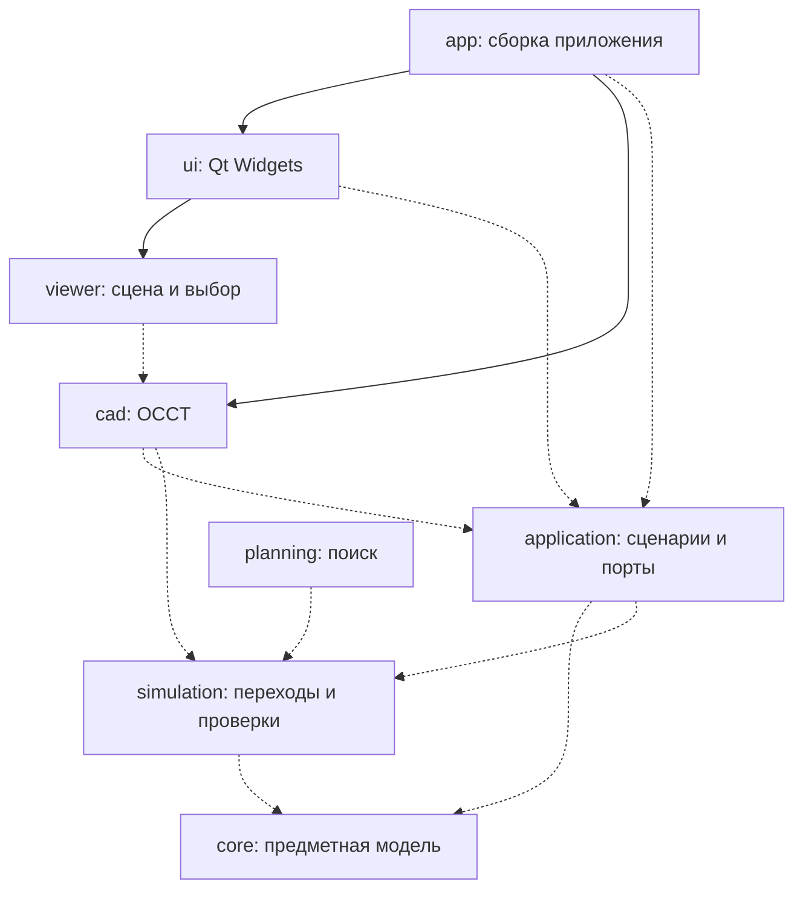

# Архитектура 3D Bending Simulator

Рабочая архитектура от 2026-10-17, D012. Выбрана в рамках поручения подготовить основу проекта. Часть границ уже закреплена в CMake; будущие контракты уточняются при реализации соответствующего сценария. История сравнения стеков — в [исследовании](research.md), продуктовые предположения — в [концепции](product.md).

## Форма приложения

Одно нативное настольное приложение: C++20, Qt 6 Widgets, OCCT 7.x, CMake. Предметные алгоритмы и сценарии отделены от виджетов и CAD SDK. Внутренние модули собираются статическими библиотеками в один исполняемый файл; Qt/OCCT поставляются согласно своим условиям. Платформы и версии — в [разработке](development.md), лицензия собственного кода — MIT.

`app/main.cpp` — точка создания и соединения компонентов. Там настраиваются Qt и зависимости, создаётся окно. Владение сервисами и передача зависимостей через конструкторы должны быть видны в коде. Интерфейс вводится там, где нужен реальный внешний адаптер или подмена в проверке сценария; иерархия абстрактных CAD-объектов заранее не создаётся.

## Границы модулей

Стрелка означает «зависит от». Сплошные связи уже реализованы; пунктирные показывают направление развития, а не существующие библиотеки.

| Модуль | Ответственность и зависимости | Состояние |
| --- | --- | --- |
| `core` / `Bending::Core` | Предметные значения и инварианты на стандартном C++; без Qt/OCCT/файлов/потоков GUI | Реализована перестановка стабильных ID гибов |
| `cad` / `Bending::Cad` | Адаптер OCCT: импорт, подготовка геометрии и диагностика. Ожидаемые ошибки SDK преобразуются на этой границе | Пока только версия SDK; интеграционный тест строит примитив |
| `viewer` / `Bending::Viewer` | Представление, камера, выбор и подсветка; впоследствии собственный мост Qt/OCCT | QWidget-заглушка; CAD-рендеринга пока нет |
| `ui` / `Bending::Ui` | Окно, панели и пользовательские команды. Сведения о CAD получает от `app`, без вызовов SDK | Реальные dock-панели, остальной сценарий ещё закрыт |
| `app` / `bending_simulator` | Создание компонентов, настройки Qt, запуск и завершение | Реализован |
| `application` | Сценарии загрузки/закрытия модели, редактирования и проверки; порты адаптеров, запросы и результаты без Qt/OCCT | Ввести с первым сценарием импорта M1 |
| `simulation` | Описание состояния, выполнение перехода и отчёт; использует `core` и узкие геометрические порты, реализуемые в `cad` | Ввести с M3–M4 |
| `planning` | Подсказки и поиск через тот же механизм переходов | После проверенного ручного сценария |
| Адаптер хранения проекта | Чтение/запись версии формата и миграции, реализует порт `application` | Ввести при сохранении реальных данных M2 |

Пустые библиотеки будущих модулей не создаются. Дополнительная библиотека появляется с первым работающим сценарием и проверкой его поведения.

Будущие стрелки `cad → application/simulation` означают реализацию их портов. Обратного compile-time вызова из этих модулей в CAD SDK нет: конкретные адаптеры подключает `app`. Благодаря этому граф зависимостей остаётся без циклов, а сценарии и переходы проверяются с небольшими тестовыми адаптерами.

У каждого существующего модуля свой `CMakeLists.txt` и публичный каталог `include/bending/<module>/`. Общего include-пути `src` нет. Заголовки реализации остаются рядом с `.cpp` и не включаются соседним модулем через относительный путь. `PUBLIC` используется для зависимостей публичного API, `PRIVATE` — для реализации. `core` отдельно собирается пресетом `core`; CI проверяет его с запрещённым поиском Qt/OCCT.

У `cad` сейчас публичный API без типов OCCT. В просмотрщике и геометрических алгоритмах разрешается узкий явно выделенный мост к OCCT: типы SDK остаются в CAD/геометрических адаптерах. Оборачивать весь OCCT в собственную копию его API не требуется. `core`, `application` и обычные панели UI SDK-типов не получают.

## Сценарий и представление

Qt-сигнал от действия окна передаётся контроллеру сценария. Контроллер запускает use case в `application`, а окно отображает состояние и диагностику. Контроллер может быть `QObject`; предметные операции остаются обычным C++. Для дерева деталей и списка операций использовать Qt Model/View, когда они получат реальные данные. Отдельный MVVM-фреймворк не нужен.

В M1 поток загрузки должен выглядеть так:

1. Пользователь выбирает путь; контроллер создаёт запрос с ID задания и ревизией текущего документа.
2. CAD-адаптер читает файл в отдельный документ и возвращает геометрию, метаданные, единицы и диагностику.
3. Контроллер принимает только актуальный результат. При ошибке текущий открытый документ сохраняется.
4. В GUI-потоке просмотрщик создаёт отображение новой геометрии, а панели получают её метаданные.

Точный порт импорта и способ владения CAD-документом определяются в M1 по этому сценарию. Прикладной контракт описывает задачу пользователя, а не методы `STEPControl_Reader` или устройство виджета. Команды undo/redo вводятся при редактировании реальных параметров; глобальная шина событий и универсальный диспетчер команд сейчас не нужны.

## Владение, потоки и ошибки

- `QWidget`, сцена, камера и графические ресурсы принадлежат GUI-потоку. Результаты worker передаются в него через queued-соединение.
- Импорт, геометрические расчёты и поиск выполняются фоновыми заданиями. Начальная политика — одна очередь CAD-заданий; распараллеливание требует отдельного доказательства безопасности данных.
- У каждого задания есть ID, ревизия входа и состояние выполнения. Закрытие проекта или новая загрузка делают старый результат неактуальным; такой результат не заменяет текущую модель.
- Отмена кооперативная. Если вызов OCCT нельзя прервать, результат отбрасывается после возврата. `terminate()` для worker не используется.
- Документ публикуется после успешной подготовки. Копии `TopoDS_Shape` могут разделять внутреннюю топологию; копия дескриптора сама по себе не изолирует изменение геометрии. Чтение отображаемой модели и её изменение в worker не выполняются одновременно.
- Владение ресурсами оформляется RAII: значения/`unique_ptr` для сервисов, Qt-parent для виджетов, совместное владение — только для реально разделяемого времени жизни снимка. Порядок завершения: прекратить приём заданий, отменить/дождаться worker, освободить сцену и документы.
- Неверный пользовательский файл, неподдерживаемая геометрия и отмена — ожидаемые результаты с кодом и сообщением. Исключения OCCT перехватываются в адаптере; они не выходят в Qt event loop. Нарушение инварианта в текущем `BendSequence` остаётся исключением стандартного C++.

Пул потоков, очередь и тип результата не создаются этим каркасом: они реализуются вместе с первым асинхронным сценарием, с тестами ошибки, отмены и устаревшего ответа.

## Предметные данные и геометрия

| Представление | Назначение |
| --- | --- |
| Исходная CAD-модель | Геометрия, топология и сведения об исходном файле; факт импорта не означает распознавание листовой детали |
| Листовая модель | Участки, зоны сгиба, толщина и происхождение параметров; вначале допускается ручное задание |
| Состояние изготовления | Форма и положение детали, выполненные сгибы, установка, инструмент и конфигурация станка |
| Отображение | CAD-представления/сетка, камера, выделение; не источник технологических инвариантов |
| Маршрут и проверка | Порядок операций и результаты общей проверки переходов |

CAD-геометрия и сетка имеют соответствие с ID объектов и ревизией документа. Индекс грани в импортированном файле не считается постоянным ID после повторного импорта или перестроения топологии. Стабильность ID гибов при перестановке не решает задачу устойчивых имён CAD-граней.

Параметры содержат происхождение: прочитано, вычислено/распознано либо задано пользователем. Предположение о толщине не записывается как подтверждённый результат.

В расчётной части длины нормализуются в **мм**, углы — в **радианы**; UI показывает градусы с явным преобразованием на границе. Используется правая система координат; локальная система детали и её размещение в системе станка хранятся раздельно. Конкретные оси станка задаются при реализации его модели. Допуски длины, угла, зазора и детализации сетки имеют единицы и входят в параметры проверки; один неявный `epsilon` для всего проекта не используется.

## Переход, достоверность и сброс результатов

Ручной маршрут и будущий планировщик вызывают один механизм:

`состояние + операция + инструмент/станок + настройки проверки → новое состояние + отчёт`

Просмотрщик показывает рассчитанные состояния. Правила допустимости не живут в анимации. Проверка движения включает объявленные промежуточные положения; проверка только конечного положения не выдаётся за проверку всей траектории. Рабочий контакт с инструментом отличается от запрещённого пересечения.

В отчёте различаются `NotChecked`, `Passed` в пределах перечисленных условий, `Failed` с причиной, `Indeterminate` и `Unsupported`. Отмена относится к состоянию задания и не превращается в положительный результат. Отчёт содержит ревизии входа, допуски, версию метода и фактический охват движения/условий.

| Изменение | Минимально необходимый сброс будущих результатов |
| --- | --- |
| Перестановка гибов | Суффикс от `min(from, to)`; это уже возвращает `BendSequence::move` |
| Параметр операции | Изменённая операция и последующие |
| Модель детали, инструмент, станок, допуски или метод проверки | Все зависимые проверки |
| Камера или выделение | Геометрическая проверка сохраняется |

Сам кэш пока не реализован. При его появлении ключ учитывает геометрию, операции, инструмент, станок, допуски и метод, а не только номер гиба. Старый результат может храниться для истории, но явно помечается неактуальным.

Поиск работает с установками и состояниями, а не только с перестановкой ID. Найденный маршрут, исчерпанный бюджет, неподдерживаемый случай и исчерпание конечной модели — разные результаты. Отсутствие решения при ограниченном поиске не доказывает невозможность изготовления.

## Проверки и развитие

Предметные инварианты проверяются без SDK; адаптеры — интеграционно на фиксированных моделях; GUI/OCCT — дополнительно в графическом сеансе на Windows и Linux. Offscreen-проверка окна не подтверждает OpenGL-рендеринг. Численные правила требуют известного входа, ожидаемого результата и явного допуска.

Первый план: [M1 — импорт и просмотр STEP](implementation-plan.md). Он проверяет жизнеспособность CAD/GUI-связки. Следующие этапы вводят параметры детали, одну операцию, затем ручной маршрут и проверки. Физический расчёт пружинения/усилия остаётся отдельным направлением.

Основания правил: [C++ Core Guidelines — ресурсы и интерфейсы](https://isocpp.github.io/CppCoreGuidelines/CppCoreGuidelines), [CMake — области видимости include](https://cmake.org/cmake/help/v3.24/command/target_include_directories.html), [Qt 6.8 — потоки и QObject](https://doc.qt.io/qt-6.8/threads-qobject.html), [OCCT — устройство TopoDS_Shape](https://github.com/Open-Cascade-SAS/OCCT/blob/V7_9_3/src/TopoDS/TopoDS_Shape.hxx). Это правила проекта на основе документации; производительность CAD-просмотрщика ими ещё не подтверждена.
