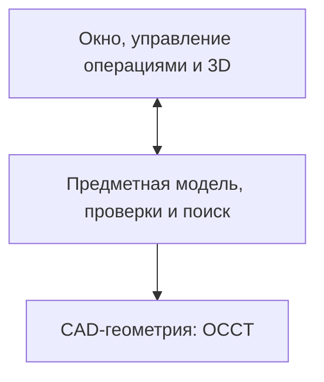

# Предлагаемая архитектура симулятора

Статус: архитектурная гипотеза, реализация не начата. Основной кандидат — Qt 6 Widgets + C++ + OCCT; предварительное предпочтение пользователя зафиксировано в D007. Главный принцип согласованного направления развития — общая модель операций и проверок для ручной последовательности и будущего автоматического поиска.

## Модули

| Модуль | Ответственность |
| --- | --- |
| Импорт CAD | Чтение поддерживаемого формата, определение единиц, подготовка геометрии и диагностика ошибок |
| Анализ листовой детали | Распознавание толщины, плоских участков и зон сгибов с возможностью исправления пользователем |
| Геометрия заготовки | Построение или загрузка развёртки, хранение принятых припусков |
| Инструмент и оборудование | Геометрия, точки установки, доступные положения и ограничения выбранной конфигурации |
| Модель операции | Изменение формы и положения детали, движение инструмента, промежуточные состояния |
| Проверка перехода | Столкновения, зазоры и другие явно реализованные ограничения с объяснением результата |
| Планировщик | Ручной маршрут, подсказки и поиск следующей операции через общий механизм проверки |
| Интерфейс | Выбор объектов, редактирование параметров, 3D-просмотр и объяснение результатов |

Физический расчёт материала при необходимости подключается отдельной расчётной подсистемой. Его результаты не следует подменять параметрами анимации.

## Представления геометрии

Предлагается хранить два связанных представления:

- CAD-геометрию с поверхностями, гранями и топологией для распознавания и геометрических операций;
- треугольную геометрию для интерактивного отображения и ускоренных пространственных проверок.

Связь между ними нужна, чтобы выбранный на экране участок соответствовал конкретной грани, зоне сгиба или инструменту. Отображаемую сетку не следует использовать как единственный источник всех инженерных параметров.

Единицы измерения, системы координат, допуски и точность сетки должны быть заданы явно. Они входят в условия воспроизводимости проверки.

## Предлагаемая модель данных

| Сущность | Основные данные |
| --- | --- |
| Деталь | Исходная модель, единицы, толщина, материал, границы поддерживаемой геометрии |
| Участок листа | Геометрия и связи с соседними участками через зоны сгибов |
| Сгиб | Ось, зона, внутренний радиус, целевой угол, направление, происхождение параметров |
| Развёртка | Контуры и линии сгибов, припуски, соответствие участкам согнутой детали |
| Инструмент | Пуансон, матрица, геометрия, длина или сегменты, параметры установки |
| Станок | Рабочее пространство, геометрия учитываемых частей и ограничения движений |
| Состояние | Текущая форма, выполненные сгибы, положение детали, инструмент и установка |
| Операция | Целевой сгиб, установка, движения, целевой угол и смены инструмента при наличии |
| Результат проверки | Статус, проверенные условия, причины отказа, положение проблемы, допуски и непроверенные ограничения |
| Маршрут | Последовательность операций, результаты проверок и оценка по выбранным критериям |

Параметры, считанные из CAD, распознанные из геометрии и заданные пользователем, нужно различать. Это помогает проверять и исправлять исходные данные.

## Проверка операции

Проверка должна охватывать необходимые промежуточные положения, а не только конечную форму. Её фактический охват зависит от реализованной модели движения: отдельно учитываются гибка, установка, извлечение и переворот.

Рабочий контакт листа с инструментом нужно отличать от запрещённого пересечения. Выбранный способ геометрических проверок и дискретизация движения ограничивают достоверность результата.

Предлагаемые статусы результата:

- пройдено в пределах перечисленных проверок;
- обнаружено нарушение с конкретной причиной;
- результат не определён из-за неполной проверки или недостаточных данных;
- операция или геометрия не поддерживается моделью.

Непроверенное условие не получает положительный результат по умолчанию.

## Автоматический поиск

Ручной интерфейс и планировщик передают операции одному модулю проверки переходов. Анимация отображает полученные состояния и не содержит самостоятельных правил допустимости маршрута.

Предлагаемая схема поиска:

1. Получить текущее состояние и возможные следующие операции.
2. Проверить кандидатов, исключить нарушения реализованных ограничений.
3. Продолжить поиск по допустимым переходам до целевой формы.
4. Сохранить маршрут вместе с установками, инструментом и основаниями его оценки.

Алгоритм поиска, эвристики и возможность повторного использования проверок выбираются после испытаний на характерных деталях. Перестановки номеров сгибов недостаточны: на выполнимость влияют положения детали и выбранная конфигурация оборудования.

Результат поиска должен различать найденный маршрут, исчерпание бюджета, неподдерживаемый случай и отсутствие допустимого маршрута в полностью исследованной конечной модели. Последнее ограничено полнотой этой модели и не является общим доказательством невозможности изготовления.

## Платформы и варианты стека

Согласно D004, Windows является обязательной платформой запуска, Linux — средой разработки, Linux-сборка желательна. Предлагаемый начальный формат — локальное настольное приложение. Версии ОС и архитектуры процессора ещё не утверждены; x86-64 рассматривается как начальный кандидат.

Следующая таблица содержит инженерную оценку вариантов, а не результаты прототипирования:

| Вариант | Сильные стороны для задачи | Основная цена |
| --- | --- | --- |
| Electron, React/TypeScript, Three.js и процесс Python/OCP | Разделение интерфейса и CAD; удобная среда для разработки интерактивного интерфейса и исследования алгоритмов | Два прикладных языка, обмен данными, упаковка Electron и Python с нативными библиотеками |
| Qt 6 Widgets, C++ и OCCT | Прямая интеграция CAD-ядра и его 3D-просмотрщика; контроль над памятью и вычислениями | Более сложная разработка C++ и интеграция нативных зависимостей; UI и предметную логику всё равно нужно разделять |
| Tauri, React/TypeScript, Three.js и процесс Python/OCP | Компактная оболочка, поддержка внешнего расчётного процесса | Добавляется слой Rust; WebView отличается на Windows и Linux; Python/CAD остаются частью поставки |

Основной кандидат — Qt Widgets/C++/OCCT. После сравнения накладных расходов пользователь сообщил, что склоняется к нему; это предварительное предпочтение, записанное в D007. Вариант позволяет напрямую использовать CAD-ядро и его просмотрщик. Совместимость конкретных версий, размер и производительность ещё не подтверждены прототипом.

Electron остаётся кандидатом при существенном преимуществе разработки на React. Tauri рассматривается как способ сохранить web-интерфейс с другой моделью поставки браузерного окружения. Производительность и надёжность каждого варианта зависят от приложения и целевой системы; пока они не измерены.

Планируемая публикация исходников и открытые зависимости подтверждены в D005–D006. У Electron/React/Three.js разрешительные лицензии, у OCCT — LGPL 2.1 с исключением. Qt также имеет открытые варианты лицензирования; его не следует исключать только из-за наличия коммерческой лицензии. Условия конкретных модулей и зависимостей сведены в [реестр](licensing.md). Лицензия самого симулятора пока не назначена.

Electron включает Chromium и Node.js. Это позволяет поставлять выбранную версию браузерного движка вместе с приложением; работу 3D всё равно нужно проверять на целевых ОС и GPU. Tauri использует WebView2 на Windows и WebKitGTK на Linux; компактность оболочки не определяет размер всего комплекта с CAD-ядром. Источники и ограничения сборки приведены в [исследовании](research.md#платформы-настольное-приложение-и-сборка).

## Архитектура независимо от оболочки

Это одно локальное приложение для пользователя. Предметные модули не зависят от UI и могут вызываться из командной строки и проверок. Общая модель операций и проверки ручного и автоматического режима сохраняются при любом варианте интерфейса.

В нативном варианте предлагаются Qt Widgets, просмотрщик OCCT и предметные модули на C++. Долгие операции выполняются вне потока интерфейса; необходимость выделенного процесса для изоляции CAD-операций выбирается при прототипировании. Python может использоваться для исследований, не становясь обязательной частью установленного приложения.

В web-варианте React/Three.js работает внутри Electron или Tauri, а Python/OCP — в отдельном расчётном процессе. Оболочка запускает и завершает этот процесс и передаёт задания. Интерпретатор и нативные библиотеки предполагается включать в поставку; работоспособность и размер такой упаковки нужно доказать прототипом.

В варианте с Python предметная логика, управление операциями и исследование алгоритмов могут быть написаны на Python. Геометрические операции OCCT при вызове через OCP выполняются в нативном ядре. Производительность Python-части, особенно перебора маршрутов, оценивается отдельно; перенос отдельных измеренных узких мест в C++ возможен как дальнейшее решение.

Для web-варианта начальная гипотеза — один расчётный процесс с очередью заданий. Выделение процессов для параллельного поиска рассматривается после измерений.

При разделении на процессы протокол предлагается строить на структурированных командах, например через стандартные потоки. Заданиям нужны идентификаторы, прогресс, отмена и диагностические результаты. Большую сетку лучше передавать отдельным бинарным артефактом с привязкой к версии модели, а не повторять её в каждом сообщении. Формат пока не утверждён.

Быстрые запросы интерфейса к сетке можно выполнять рядом с 3D-сценой. Итоговая проверка операции для ручного режима и поиска маршрута должна иметь один источник правил в расчётной части.

FastAPI остаётся вариантом при появлении сетевого API или браузерного режима; локальный настольный сценарий сам по себе не требует HTTP-сервера. Обработка CAD в браузере через OpenCascade.js также остаётся исследовательской альтернативой.

## Основной кандидат Qt Widgets C++ OCCT

Дополнение реализации от 2026-10-17: по запросу создания основы начат каркас C++20/CMake с целями `bending_core`, `bending_cad`, `bending_viewer` и приложением. Начальные версии и проверяемые платформы перечислены в [руководстве разработчика](development.md). Описание ниже сохраняет проектируемые границы; весь перечень возможностей пока не реализован. В частности, viewer сейчас QWidget-заглушка; интеграция QOpenGLWidget/OCCT остаётся следующей проверкой.

Предлагается одно нативное приложение с несколькими модулями. C++ используется в прикладном коде и при обращении к OCCT, CMake — для конфигурации сборки. Версии и стандарт C++ выбираются после проверки совместимого набора зависимостей; более новый стандарт собственного кода не требует автоматически пересобирать все сторонние библиотеки с теми же флагами, но ABI и компиляторы должны быть совместимы.

Предлагаемые границы модулей, а не уже существующие каталоги:

| Модуль | Ответственность | Граница |
| --- | --- | --- |
| `ui` | Окно, панели, дерево операций, свойства, меню и пользовательские команды | Qt Widgets; передаёт команды и отображает результаты |
| `viewer` | Камера, показ детали и инструмента, выбор граней и рёбер, подсветка | Просмотрщик OCCT и интеграция с Qt/OpenGL |
| `cad` | Импорт STEP, единицы, диагностика геометрии, доступ к граням и телам | Изолирует геометрические операции OCCT от действий окна |
| `simulation` | Участки листа, сгибы, состояния и проверка перехода | Самостоятельная предметная логика C++, вызываемая из UI и планировщика |
| `planning` | Подсказки, поиск порядка и оценка маршрутов | Использует общую модель и проверку из `simulation` |
| `project` | Сохранение параметров, исходных моделей и последовательности | Формат данных и версионирование пока не выбраны |

Визуализацию предлагается строить на собственном просмотрщике OCCT: так выбор CAD-граней и рёбер остаётся связан с геометрической моделью. Кандидат интеграции — `QOpenGLWidget`; потребуется согласовать OpenGL-контекст, framebuffer и управление ресурсами Qt/OCCT. Это нужно проверить в первом прототипе, а не считать готовым только по наличию примера.

Начальная модель исполнения — один процесс, GUI и отображение в главном потоке, тяжёлые CAD-операции и поиск в фоновых заданиях. У Qt есть и более сложные схемы многопоточного рендеринга, но для старта они не требуются. Рабочая задача не изменяет виджеты или графический контекст напрямую; результаты и прогресс передаются в поток интерфейса.

Для начала целесообразна одна очередь изменяющих CAD-заданий. До распараллеливания определить владение геометрией и не допускать одновременного чтения отображаемой модели и её изменения без согласованной схемы. Отмена и обработка ошибок проектируются для конкретных операций: фоновый запуск сам по себе не делает любой вызов OCCT прерываемым. Отдельный расчётный процесс можно выделить при необходимости изоляции.

OCCT даёт геометрию, обмен CAD-данными и просмотрщик. Механика листогибочного пресса, распознавание сгибов, технологические правила и поиск последовательности остаются нашей предметной частью; состав подходящих готовых алгоритмов исследуется отдельно.

Первая проверка этого направления — небольшой просмотрщик STEP с выбором грани, фоновым импортом и Windows/Linux-сборкой. После проверки интеграции можно переходить к одной операции гибки с заданными пользователем параметрами. Архитектура не требует строить полный редактор CAD до моделирования первой операции.

## Сборка и доставка

Предлагается разрабатывать и запускать Linux-версию локально, а выпускать платформенные артефакты в отдельных средах:

- Windows-среда собирает и проверяет расчётную часть с Windows-библиотеками и установщик приложения.
- Linux-среда собирает и проверяет соответствующий комплект для выбранной базы дистрибутива.
- Исходники предметной логики, протокол и формат проекта остаются общими; поставляемые нативные бинарники различаются.

Для стартового каркаса выбран GitHub Actions с Windows- и Linux-runner. Workflow проверяет версию и форматирование, собирает, запускает тесты и проверяет комплект. По тегу готовится черновик GitHub Release; [процесс выпуска](releases.md). Другие инфраструктуры остаются возможными позднее.

Для нативного варианта рассматриваются CMake и платформенная сборка Qt/OCCT. В Windows необходимо собрать и проверить комплект DLL и плагинов, например с помощью инструмента Qt `windeployqt` и отдельного учёта библиотек OCCT.

Для web-варианта PyInstaller — кандидат для упаковки Python-процесса. Он собирает комплект для той ОС, на которой запускается. Наличие Windows-пакетов OCP не подтверждает, что весь worker автоматически упакуется без настройки: нужно проверить DLL, ресурсы и загрузку библиотек в установленном приложении.

При выборе Electron его установщик может собираться через electron-builder. NSIS `.exe` для Windows и AppImage/`.deb` для выбранных Linux-систем рассматриваются как варианты, а не обещанные форматы. Прямую сборку всех Windows-компонентов на Linux не следует делать условием выбора стека.

Если позже понадобится интеграция с API установленной CAD-системы, её платформенные зависимости оформляются отдельным адаптером. Путь работы с нейтральными файлами должен оставаться отделённым от такого адаптера.

## Минимальная проверка жизнеспособности стека

До окончательного выбора полезен небольшой технический прототип. Первым предлагается оценить нативный вариант, сохраняя одну характерную деталь и сценарий для сопоставления с web-вариантом при необходимости:

1. Импортировать один характерный STEP, проверить единицы и связь отображения с гранями.
2. Отобразить деталь в настольном окне, выполнить выбор грани и вращение камеры.
3. Запустить длительную операцию вне потока UI, проверить прогресс и отмену.
4. Упаковать и запустить комплект на Windows без инструментов разработки и вручную установленных зависимостей.
5. Проверить Linux-сборку, пути с пробелами и кириллицей, загрузку файлов и базовую 3D-сцену.

Успешная сборка в CI не заменяет проверку 3D на целевой Windows-системе и характерной видеокарте. Этот прототип ещё не выполнен.

## Размер и отзывчивость

Архив Electron для Windows x64 в просмотренном выпуске сам по себе занимает около 151 MiB. Для Python/OCP нужно учитывать также нативные зависимости, включая VTK в просмотренном wheel. Эти данные и точные границы измерения приведены в [исследовании](research.md#размер-поставки-и-отзывчивость).

Нужно различать размер скачивания, объём после установки, память запущенного приложения и задержки интерфейса. Маленький установщик Tauri при использовании системного WebView не означает отсутствие браузерного runtime в системе или его потребления памяти. Нативный Qt-вариант также поставляет библиотеки и требует измерений.

Для сравнения фиксировать версии, целевую ОС, ПК, модель, детализацию и сценарий. Измерять:

- установщик и установленный комплект со всеми необходимыми runtime;
- холодный запуск до готовности к вводу;
- память всего приложения без детали, с деталью и пиковую память при импорте;
- время кадра при вращении камеры и анимации гиба, задержки ввода во время расчёта;
- корректность импорта, выбора граней, движения и восстановления после ошибок.

Сборка должна избегать расчётов в потоке UI, лишнего копирования больших сеток между процессами и пересоздания всей геометрии на каждом кадре. Выбор другой оболочки сам по себе не обеспечивает отсутствие лагов, CAD-ошибок или проблем GPU. Численные бюджеты размера, RAM и времени кадра, а также минимальная конфигурация ПК пока не заданы.

Способ хранения проектов, окончательный протокол, версии зависимостей, минимальные ОС и форматы упаковки пока не выбраны.

Актуализировано: 2026-10-17.
