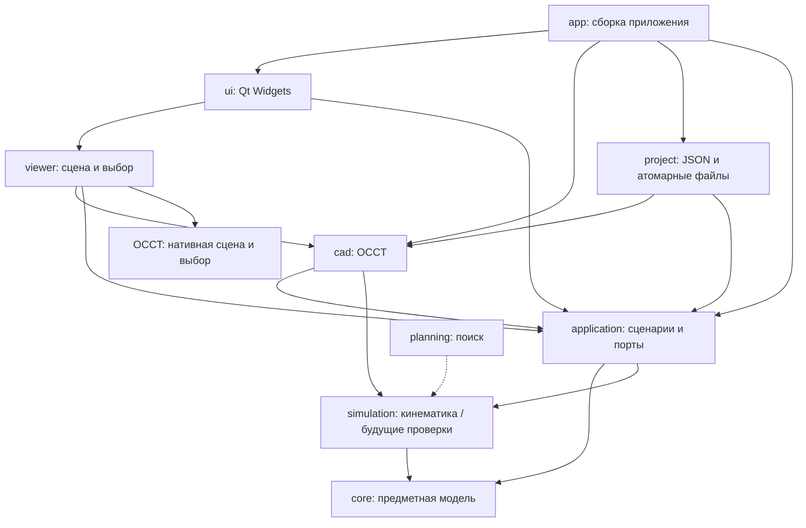

# Архитектура 3D Bending Simulator

Рабочая архитектура от 2026-10-17, D012. Выбрана в рамках поручения подготовить основу проекта. Часть границ уже закреплена в CMake; будущие контракты уточняются при реализации соответствующего сценария. История сравнения стеков — в [исследовании](research.md), продуктовые предположения — в [концепции](product.md).

## Форма приложения

Одно нативное настольное приложение: C++20, Qt 6 Widgets, OCCT 7.x, CMake. Предметные алгоритмы и сценарии отделены от виджетов и CAD SDK. Внутренние модули собираются статическими библиотеками в один исполняемый файл; Qt/OCCT поставляются согласно своим условиям. Платформы и версии — в [разработке](development.md), лицензия собственного кода — MIT.

`app/main.cpp` — точка создания и соединения компонентов. Там настраиваются Qt и зависимости, создаётся окно. Владение сервисами и передача зависимостей через конструкторы должны быть видны в коде. Интерфейс вводится там, где нужен реальный внешний адаптер или подмена в проверке сценария; иерархия абстрактных CAD-объектов заранее не создаётся.

## Границы модулей

Стрелка означает «зависит от». Сплошные связи уже реализованы; пунктирные показывают направление развития, а не существующие библиотеки.

| Модуль | Ответственность и зависимости | Состояние |
| --- | --- | --- |
| `core` / `Bending::Core` | Предметные значения и инварианты на стандартном C++; без Qt/OCCT/файлов/потоков GUI | Реализованы перестановка ID и целевые параметры сгиба с проверкой диапазона |
| `cad` / `Bending::Cad` | Адаптер OCCT: импорт, подготовка геометрии и диагностика. Ожидаемые ошибки SDK преобразуются на этой границе | `CadDocument` и синхронный `StepImporter`: одно тело, мм, метаданные, диагностика; без GUI |
| `viewer` / `Bending::Viewer` | Представление, камера, выбор и подсветка; собственный мост Qt/OCCT за PIMPL | Нативный QWidget/OCCT, импортированный документ через узкий SDK-мост, камера и выбор грани текущей ревизии |
| `ui` / `Bending::Ui` | Окно, панели и пользовательские команды. Сведения о CAD получает от `app`, без вызовов SDK | Диалог STEP, свойства, ошибки, команды отмены/закрытия и Qt-контроллер одного worker |
| `app` / `bending_simulator` | Создание компонентов, настройки Qt, запуск и завершение | Реализован |
| `application` / `Bending::Application` | Прикладные типы документа, порт импорта и DocumentSession без Qt/OCCT | Реализованы ревизии, приём актуального результата, ошибка, отмена и закрытие |
| `simulation` / `Bending::Simulation` | Чистая геометрическая кинематика, зависит от core; будущие переходы и отчёты расширяют тот же механизм | Один равномерный сгиб с постоянной длиной средней поверхности; отдельная начальная установка инструмента/проверка опор, контактный ход с 41 проверенным положением, без физики/непрерывного sweep |
| `planning` | Подсказки и поиск через тот же механизм переходов | После проверенного ручного сценария |
| `project` / `Bending::Project` | Порты DocumentImporter/ProjectWriter, Qt Core JSON/SHA-256/QSaveFile и STEP-адаптер | Переносимый `.bend` v3, чтение v1/v2, подтверждения/задания и привязка по геометрии |

Пустые библиотеки будущих модулей не создаются. Дополнительная библиотека появляется с первым работающим сценарием и проверкой его поведения.

Стрелка `cad → application` означает реализацию порта импорта; `cad → simulation` — реализации кинематики/начальной установки. Обратного compile-time вызова из этих модулей в CAD SDK нет: конкретные адаптеры подключает `app`. Благодаря этому граф зависимостей остаётся без циклов, а сценарии и переходы проверяются с небольшими тестовыми адаптерами.

У каждого существующего модуля свой `CMakeLists.txt` и публичный каталог `include/bending/<module>/`. Общего include-пути `src` нет. Заголовки реализации остаются рядом с `.cpp` и не включаются соседним модулем через относительный путь. `PUBLIC` используется для зависимостей публичного API, `PRIVATE` — для реализации. `core` отдельно собирается пресетом `core`; CI проверяет его с запрещённым поиском Qt/OCCT.

У `cad` сейчас публичный API без типов OCCT. В просмотрщике и геометрических алгоритмах разрешается узкий явно выделенный мост к OCCT: типы SDK остаются в CAD/геометрических адаптерах. `ViewerWidget` публикует Qt/прикладной API без SDK-типов, а OCCT-сцена скрыта в `.cpp`. `Bending::CadOcct` открывает только отдельный include-каталог нативного моста для viewer; обычный UI его не подключает. Диагностический примитив создаётся явно в графических проверках, обычный запуск начинает с пустой сцены. Оборачивать весь OCCT в собственную копию его API не требуется. `core`, `application` и обычные панели UI SDK-типов не получают.

M1.3–M1.4, D017: стандартные DTO и интерфейсы `Document`/`DocumentImporter` находятся в `application`. `CadDocument` реализует документ, `StepImporter::load` — порт. Низкоуровневый `read` сохраняет результат `unique_ptr<const CadDocument>`/ошибка; прикладной `load` публикует `shared_ptr<const Document>` для действительно совместного времени жизни session и viewer. Геометрия принадлежит CAD PIMPL. Перед публикацией worker вычисляет свойства граней и триангуляцию. Обычный UI не получает SDK-дескрипторов.

`DocumentSession` — последовательная машина состояния без потоков: ID запроса, базовая ревизия, фаза, текущий снимок и ошибка. `ui::ImportController` владеет одним QThread и QObject-worker, кооперативной отменой и единственным заменяемым ожидающим запросом. Worker передаёт данные queued-вызовами. Контроллер проверяет актуальность результата, вызывает GUI-presenter и лишь после принятия публикует новую ревизию. Ошибка чтения/подготовки/презентации сохраняет прежний снимок. SDK-мост viewer читает подготовленную геометрию; автоматическая повторная триангуляция импортированной модели отключена. При недоступном 3D-backend остаются метаданные и явная графическая диагностика; это не считается проверкой рендеринга. Подробный контракт — [step-import.md](step-import.md).

Графический мост M1.1 использует нативный QWidget и `Aspect_NeutralWindow`: OCCT создаёт OpenGL-контекст для HWND/X11 window. Qt не создаёт второй контекст и framebuffer. Это начальная реализация для Windows и Linux/X11; Wayland требует XWayland и `QT_QPA_PLATFORM=xcb`. Физические размеры и координаты мыши учитывают DPR. При недоступной платформе/ошибке контекста показывается диагностика, а не фиктивная 3D-сцена. Выбор и ограничения — D014 и [результаты исследования](research.md#прототип-просмотрщика-m11).

M2, D018: до публикации CAD-адаптер определяет толщину поддерживаемой плоской геометрии. Результат содержит происхождение и пары граней текущего импорта; приложение не считает локальное расстояние доказательством постоянства толщины. `Document` удерживает исходные STEP-байты, а не читает их заново при сохранении. `DocumentSession` владеет ручным переопределением/путём/признаком изменений и отдельной ревизией редактирования. Изменение параметра не меняет геометрию.

Адаптер `project::ProjectFiles` собирается только с приложением и использует уже имеющийся Qt Core; application/core остаются без Qt/OCCT. `app` передаёт порты чтения и записи окну, а worker выполняет сохранение снимка. ID сохранения и ревизия редактирования защищают от позднего ответа. Формат встраивает STEP, заново проверяет/распознаёт его при открытии, не сохраняет нестабильные индексы граней; детали — [sheet-thickness-project.md](sheet-thickness-project.md).

M2.1, D019: `BendAnalysis` вычисляется в том же worker после анализа толщины и до триангуляции. Это локальные измерения геометрии с поверхностями текущего снимка, не операции изготовления. UI получает стандартные DTO и отображает их через Qt Model/View; SDK-вызовов из панели нет. `ViewerWidget::highlightBend` получает DTO и ревизию, различает основную цилиндрическую зону и контекст полок. Цвет задаётся только в `AIS_ColoredShape`; CAD-геометрия остаётся неизменной. Состояние роли/цвета, как и маска толщины, восстанавливается после пересоздания native-ресурсов. `.bend` v1 сохраняет STEP и пересчитывает измерения при открытии; номера зон и индексы граней не сериализуются. [Контракт распознавания](bend-recognition.md).

D020: пользовательские `BendPreparation` принадлежат `DocumentSession`, отдельно от `DocumentMetadata::bendAnalysis`. Они содержат ID в пределах проекта, статус и необязательный `core::BendTarget`. Application публично зависит от core. При повторном открытии `restoreBendPreparations` восстанавливает только взаимно однозначные совпадения геометрических отпечатков; неразрешённые записи сохраняются и показываются явно. Перед presenter проверяются сохранённые параметры. `.bend` v2 хранит эти записи без индексов граней; v1 открывается с непроверенными зонами, следующее сохранение пишет v2. Worker получает копию пользовательских записей, GUI принимает ответ по ID сохранения/edit revision. Контракт, диапазоны и пределы устойчивости — [bend-preparation.md](bend-preparation.md).

D021: `simulation::SingleBend`/`singleBendSection` определяют геометрию одной прямой зоны без SDK/Qt. Application публично зависит от simulation и публикует порт подготовки. CAD-адаптер восстанавливает две полки и локальный базис, проверяет всю конечную форму обеими булевыми разностями и создаёт 21 независимый mesh-снимок. Исходные топология/триангуляция не меняются. `ImportController` выполняет подготовку в прежнем worker, защищает приём ID и геометрической/edit-ревизиями. Viewer через `OcctPreviewAccess` показывает кадры, сохраняя исходный документ и отдельную маску подсветки; выбор CAD-граней отключён. Ползунок/таймер выбирают только рассчитанные кадры. Настройки просмотра не сохраняются в v2. [Границы и модель](single-bend-preview.md).

D022: `core::PressTools` хранится у BendPreparation; `.bend` v3 читает v1/v2. `simulation::flatToolSetup` вычисляет плоское положение и опоры, CAD проверяет всю форму источника и строит один кадр с инструментами, проверяя парные объёмные пересечения. Существующий порт `SingleBendPreviewBuilder::buildToolSetup` и та же очередь/защита ревизий; наличие `toolSetup` отличает статический результат от 21 состояния кинематики. Viewer показывает подготовленные профили в системе машины Y вверх, UI не включает воспроизведение. [Границы](press-tool-setup.md).

D023: `simulation::PressMotion` вычисляет сечение с двумя опорами и положением пуансона, консервативно ограничивает опору на всём интервале. CAD строит 41 кадр, проверяет контакты/объём/парные пересечения в каждом и публикует immutable отчёты. Существующий builder получает `buildToolMotion`, controller использует `BendPreviewMode` и проверяет соответствие результата запросу. Тот же worker/ID/ревизии; формат остаётся v3. Viewer ориентирует инструмент по Y вверх, UI читает метаданные кадра. Топология инструмента может разделяться между кадрами с разными rigid locations; все mesh-операции завершаются в worker до публикации. [Контракт](single-bend-tool-motion.md).

## Сценарий и представление

Qt-сигнал от действия окна передаётся контроллеру сценария. Контроллер запускает use case в `application`, а окно отображает состояние и диагностику. Контроллер может быть `QObject`; предметные операции остаются обычным C++. Для дерева деталей и списка операций использовать Qt Model/View, когда они получат реальные данные. Отдельный MVVM-фреймворк не нужен.

В M1 поток загрузки должен выглядеть так:

1. Пользователь выбирает путь; контроллер создаёт запрос с ID задания и ревизией текущего документа.
2. CAD-адаптер читает файл в отдельный документ и возвращает геометрию, метаданные, единицы и диагностику.
3. Контроллер принимает только актуальный результат. При ошибке текущий открытый документ сохраняется.
4. В GUI-потоке просмотрщик создаёт отображение новой геометрии, а панели получают её метаданные.

Порт импорта и владение документом реализованы в M1.3–M1.4 по этому сценарию. Прикладной контракт описывает задачу пользователя, а не методы `STEPControl_Reader` или устройство виджета. Команды undo/redo вводятся при редактировании реальных параметров; глобальная шина событий и универсальный диспетчер команд сейчас не нужны.

## Владение, потоки и ошибки

- `QWidget`, сцена, камера и графические ресурсы принадлежат GUI-потоку. Результаты worker передаются в него через queued-соединение.
- Импорт, геометрические расчёты и поиск выполняются фоновыми заданиями. Начальная политика — одна очередь CAD-заданий; распараллеливание требует отдельного доказательства безопасности данных.
- У каждого задания есть ID, ревизия входа и состояние выполнения. Закрытие проекта или новая загрузка делают старый результат неактуальным; такой результат не заменяет текущую модель.
- Отмена кооперативная. Если вызов OCCT нельзя прервать, результат отбрасывается после возврата. `terminate()` для worker не используется.
- Документ публикуется после успешной подготовки. Копии `TopoDS_Shape` могут разделять внутреннюю топологию; копия дескриптора сама по себе не изолирует изменение геометрии. Чтение отображаемой модели и её изменение в worker не выполняются одновременно.
- Владение ресурсами оформляется RAII: значения/`unique_ptr` для сервисов, Qt-parent для виджетов, совместное владение — только для реально разделяемого времени жизни снимка. Порядок завершения: прекратить приём заданий, отменить/дождаться worker, освободить сцену и документы.
- Неверный пользовательский файл, неподдерживаемая геометрия и отмена — ожидаемые результаты с кодом и сообщением. Исключения OCCT перехватываются в адаптере; они не выходят в Qt event loop. Нарушение инварианта в текущем `BendSequence` остаётся исключением стандартного C++.

Одна очередь и результат реализованы в M1.3 с тестами ошибки, отмены, закрытия и устаревшего ответа. Пул вычислительных потоков не вводится: для начального импорта достаточно одного worker.

## Предметные данные и геометрия

| Представление | Назначение |
| --- | --- |
| Исходная CAD-модель | Геометрия, топология и сведения об исходном файле; факт импорта не означает распознавание листовой детали |
| Листовая модель | Участки, зоны сгиба, толщина и происхождение параметров; вначале допускается ручное задание |
| Состояние изготовления | Форма и положение детали, выполненные сгибы, установка, инструмент и конфигурация станка |
| Отображение | CAD-представления/сетка, камера, выделение; не источник технологических инвариантов |
| Маршрут и проверка | Порядок операций и результаты общей проверки переходов |

CAD-геометрия и сетка имеют соответствие с ID объектов и ревизией документа. Индекс грани в импортированном файле не считается постоянным ID после повторного импорта или перестроения топологии. Стабильность ID гибов при перестановке не решает задачу устойчивых имён CAD-граней.

Параметры содержат происхождение: прочитано, вычислено/распознано либо задано пользователем. Предположение о толщине не записывается как подтверждённый результат.

В расчётной части длины нормализуются в **мм**, углы — в **радианы**; UI показывает градусы с явным преобразованием на границе. Используется правая система координат; локальная система детали и её размещение в системе станка хранятся раздельно. Конкретные оси станка задаются при реализации его модели. Допуски длины, угла, зазора и детализации сетки имеют единицы и входят в параметры проверки; один неявный `epsilon` для всего проекта не используется.

## Переход, достоверность и сброс результатов

Ручной маршрут и будущий планировщик вызывают один механизм:

`состояние + операция + инструмент/станок + настройки проверки → новое состояние + отчёт`

Просмотрщик показывает рассчитанные состояния. Правила допустимости не живут в анимации. Проверка движения включает объявленные промежуточные положения; проверка только конечного положения не выдаётся за проверку всей траектории. Рабочий контакт с инструментом отличается от запрещённого пересечения.

В отчёте различаются `NotChecked`, `Passed` в пределах перечисленных условий, `Failed` с причиной, `Indeterminate` и `Unsupported`. Отмена относится к состоянию задания и не превращается в положительный результат. Отчёт содержит ревизии входа, допуски, версию метода и фактический охват движения/условий.

| Изменение | Минимально необходимый сброс будущих результатов |
| --- | --- |
| Перестановка гибов | Суффикс от `min(from, to)`; это уже возвращает `BendSequence::move` |
| Параметр операции | Изменённая операция и последующие |
| Модель детали, инструмент, станок, допуски или метод проверки | Все зависимые проверки |
| Камера или выделение | Геометрическая проверка сохраняется |

Сам кэш пока не реализован. При его появлении ключ учитывает геометрию, операции, инструмент, станок, допуски и метод, а не только номер гиба. Старый результат может храниться для истории, но явно помечается неактуальным.

Поиск работает с установками и состояниями, а не только с перестановкой ID. Найденный маршрут, исчерпанный бюджет, неподдерживаемый случай и исчерпание конечной модели — разные результаты. Отсутствие решения при ограниченном поиске не доказывает невозможность изготовления.

## Проверки и развитие

Предметные инварианты проверяются без SDK; адаптеры — интеграционно на фиксированных моделях; GUI/OCCT — дополнительно в графическом сеансе на Windows и Linux. Offscreen-проверка окна не подтверждает OpenGL-рендеринг. Численные правила требуют известного входа, ожидаемого результата и явного допуска.

Первый план: [M1 — импорт и просмотр STEP](implementation-plan.md). Он проверяет жизнеспособность CAD/GUI-связки. Следующие этапы вводят параметры детали, одну операцию, затем ручной маршрут и проверки. Физический расчёт пружинения/усилия остаётся отдельным направлением.

Основания правил: [C++ Core Guidelines — ресурсы и интерфейсы](https://isocpp.github.io/CppCoreGuidelines/CppCoreGuidelines), [CMake — области видимости include](https://cmake.org/cmake/help/v3.24/command/target_include_directories.html), [Qt 6.8 — потоки и QObject](https://doc.qt.io/qt-6.8/threads-qobject.html), [OCCT — устройство TopoDS_Shape](https://github.com/Open-Cascade-SAS/OCCT/blob/V7_9_3/src/TopoDS/TopoDS_Shape.hxx). Это правила проекта на основе документации; производительность CAD-просмотрщика ими ещё не подтверждена.

D024: точная геометрия двух полок выделяется в CAD из исходного STEP операциями Common без изменения аргументов. Глубокая копия без mesh отделяет её от документа; каждый кадр получает отдельную трансформированную копию. Simulation::SingleBend содержит охватывающие A/B, а не описание отверстий. Допуск подтверждается разложением всего тела, фактическим объёмом, сплошным опорным участком и расстоянием до соответствующей линии плеча; UI не воспроизводит эти SDK-правила. Новые порты, зависимости и формат проекта не требуются.

D025: simulation описывает полный цикл с Retracting; на отводе деталь фиксирована. CAD строит точное занятое тело вертикального переноса параметрического пуансона и проверяет его Common со всей конечной деталью и матрицей. Application::PunchRetractionCheck содержит подъём и измеренный конечный минимальный зазор. Controller отклоняет ToolMotion без положительного конечного отчёта/фазы отвода, старые revision guards сохраняются. UI получает фазу и границы проверки, без SDK-расчётов; `.bend` v3 не хранит кадры/сертификат. Контракт — [punch-return.md](punch-return.md).

D026: `BendAnalysis::interiorContourDiagnostics` отделяет кандидатов с внутренними контурами от принятых `bends`. Только последние участвуют в привязке/редактировании заданий. CAD анализирует соседство контуров в прежнем worker; viewer получает роли граней и ревизию без изменения source. UI добавляет строки D после B, показывает причину и блокирует подготовку. CAD-builder независимо отклоняет документ с такими контурами во всех режимах. `.bend` не хранит диагностику и повторяет анализ встроенного STEP. Контракт — [bend-zone-openings.md](bend-zone-openings.md).

D027: исследовательский FEM живёт отдельно в `experiments/bend-hole`: генерация собственной заготовки/сетки, внешний процесс CalculiX и постобработка завершённых полей. Он не меняет `DocumentSession`, основной worker, CAD-снимок, кадры кинематики и `.bend`. HTML — просмотр рассчитанных узлов, без нового решателя в браузере. Интеграционный порт появится после проверки физической модели с реальным потребителем, ревизиями/отменой и условиями поставки. [Контракт эксперимента](fem-bend-hole.md).
