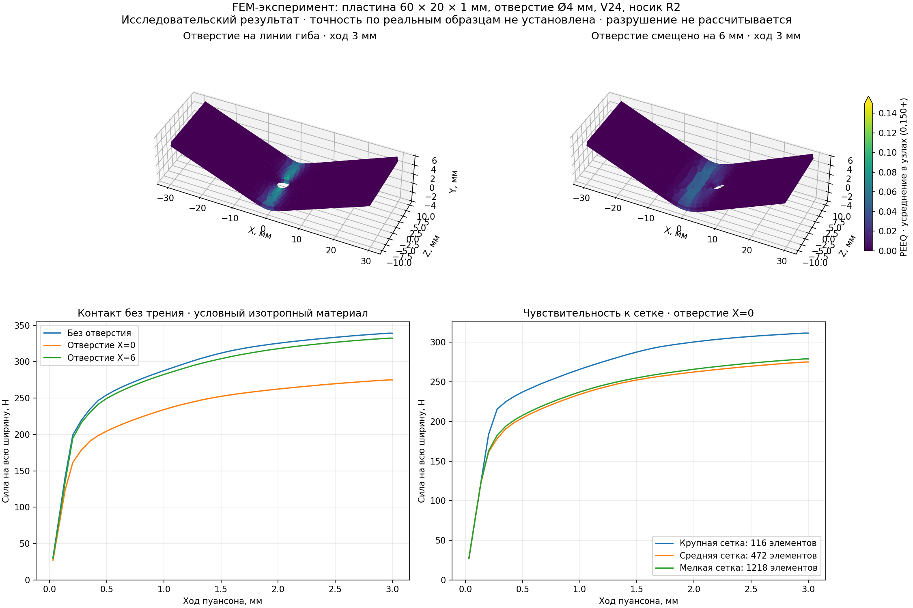

# FEM-эксперимент: отверстие в зоне гибки

D027, 2026-10-18. По поручению пользователя выполнена попытка отдельного физического расчёта до интеграции в приложение. Статус — исследовательский прототип на синтетических данных. Он не снимает ограничения D026 в основном Qt/OCCT-приложении, не импортирует произвольный STEP и не подтверждает технологичность производственной детали.

Текущее дополнение D028: [запуск учебного расчёта из программы](fem-app-workflow.md). Это отдельный сценарий с теми же фиксированными геометрией/материалом, а не прогноз деформации импортированного STEP.

## Постановка

Плоская пластина **60 × 20 × 1 мм**, круглый сквозной контур **Ø4 мм**. Сравниваются целая пластина, отверстие на X=0 и отверстие на X=6 мм. Ось гиба — Z, перемещение пуансона — отрицательная Y. Геометрия и сетка генерируются заново собственным кодом из примитивов, производственные файлы не используются.

Матрица: V90°, номинальное раскрытие 24 мм, плечи R2; фактические верхние точки касания при малом прогибе разнесены на `24 + 4×tan(π/8) = 25,656854 мм`. Пуансон: угол 85°, носик R2, высота профиля 12 мм. Инструмент жёсткий, длина перекрывает пластину. Начальное состояние — касание плоской пластины, без отдельного подвода. Основной ход **3 мм**, без задания целевого угла. Форма и радиус получаются из равновесия FEM, постоянная цилиндрическая кривизна не навязывается.

Условный изотропный материал: E=210000 МПа, ν=0,3, ρ=7,85×10⁻⁹ т/мм³. Точки истинного напряжения и пластической логарифмической деформации: `(250 МПа, 0)`, `(350, 0,02)`, `(450, 0,10)`, `(550, 0,25)`, изотропное упрочнение. Это учебная кривая, не паспорт конкретной марки стали. Анизотропия прокатки, начальные напряжения, повреждение, разрыв и реальная скорость пресса не заданы.

Квазистатическая нелинейная постановка CalculiX `*STATIC, NLGEOM`. Параметр времени 0…1 — доля приложения нагрузки, не продолжительность реального цикла. Сила тяжести плавно включается вместе с первым шагом; для баланса сил учитывается её фактическая доля. Базовый контакт **без трения**, face-to-face penalty с K=100000 Н/мм³. Три перемещения и три поворота каждого жёсткого инструмента заданы явно; меняется только Y пуансона.

Используется половина ширины Z≥0: на Z=0 задано UZ=0, плоскость симметрии исключена из внешних контактных граней. Для удаления поперечного дрейфа UX=0 в одной точке `(0; t/2; W/2)`, специально включённой в сетку. Концы полок по X свободны для подачи. Сила на всю ширину равна удвоенной реакции пуансона. Полная форма в отчёте восстановлена отражением; это допустимо для выбранной симметрии геометрии/нагрузки, не для произвольной детали.

## Реализация и повторение

`experiments/bend-hole` — отдельные Python-скрипты и Docker-рецепт Ubuntu 24.04: **CalculiX 2.21-1**, **Gmsh 4.12.1+ds1-1.1build2**, NumPy, Matplotlib. Solver и mesher зафиксированы версиями пакетов; остальные пакеты/базовый образ могут получать обновления Ubuntu. Входной deck имеет SHA-256, сохраняются параметры, версии, начальная сеточная проверка, число потоков, время и исходные результаты. Побайтовая идентичность всех повторных запусков не заявляется.

Gmsh: алгоритм 6 с рекомбинацией и вытягиванием, квадратичные элементы; в CalculiX используются C3D20R и, если получены при построении, C3D15. Проверяются аналитический/CAD-объём заготовки и положительный минимальный Jacobian в проверяемых Gmsh точках исходных элементов. Это не доказательство положительности во всём объёме деформированной сетки. Собственный reader читает штатную Abaqus-нумерацию, продолжения связности и границы объёмных элементов.

Решатель запускается отдельным процессом с двумя потоками и пределом 1800 с на случай. Основной набор допускает два независимых случая одновременно. Существующие данные случая не перезаписываются. Ошибка/таймаут/незавершённый шаг не выдаются за нулевую силу или успешную гибку. Для приёма требуются успешный exit, `Job finished`, завершённый последний шаг, полные поля перемещений/напряжений/PEEQ и соответствующие реакции. Индексы/кадры не относятся к CAD-документу или `.bend`.

Команды — [README эксперимента](../experiments/bend-hole/README.md). HTML показывает только сохранённые кадры, перемещения ×1, инструмент каркасом, поле PEEQ и силу; не рассчитывает новую форму в браузере. Ползунок, воспроизведение/пауза и вращение камеры относятся к постобработке. Цвет PEEQ насыщается при 0,150; большие значения отдельно видны числом. Страница самостоятельная, без CDN и сервера. PNG создаётся Matplotlib. Крупные сетки/сырой вывод остаются в игнорируемом `out/`; публичные контрольные числа и изображение получены только из собственной геометрии.

## Проверки и первые результаты

Упругая балка шириной 4 мм без отверстия, ход 0,01 мм: `48EIδ/L³ = 1,98943 Н`, CalculiX — `1,94490 Н`, отличие **2,24%**. Формула использует фактический начальный пролёт плеч. Она проверяет простую упругую нагрузку/единицы/контакт, но не точность пластической деформации отверстия.

При ходе 3 мм, на средней сетке, сила для всей ширины:

| Случай | Сила |
| --- | ---: |
| Без отверстия | 339,097 Н |
| Отверстие X=0 | 275,044 Н |
| Отверстие X=6 мм | 332,307 Н |

Снижение около 19% и 2% относится только к этим входам. Это не коэффициенты для расчёта произвольных перфораций или реального пресса.

| Сетка, отверстие X=0 | Элементов пластины в половине | Сила | Максимум PEEQ в усреднённых узлах |
| --- | ---: | ---: | ---: |
| h=3 мм, у отверстия 1,2 мм, 1 слой | 116 | 311,433 Н | 0,126922 |
| h=2 мм, у отверстия 0,8 мм, 2 слоя | 472 | 275,044 Н | 0,154512 |
| h=1,5 мм, у отверстия 0,5 мм, 3 слоя | 1218 | 278,935 Н | 0,147979 |

Последние две сетки различаются по силе на **1,4%**, по максимуму PEEQ — примерно на **4,4%**. Изменение немонотонно; это проверка чувствительности, не установленная асимптотическая ошибка. Крупная сетка недостаточна для количественного вывода. Уменьшение максимального шага с 0,025 до 0,0125 даёт 275,078 Н; удвоение K — 275,024 Н. Малые изменения силы не доказывают точность локальных полей.

Контрольные числа, входы, версии/параметры запуска и истории сохранены в [reference-results.json](../experiments/bend-hole/reference-results.json). Это снимок опыта, не эталон производственной точности; времена относятся к данному локальному запуску с двумя потоками на процесс.

Воспроизводимость входа проверена повторной генерацией всех девяти `.inp` окончательным генератором: SHA-256 совпали с использованными расчётом. [Запись проверки](../experiments/bend-hole/deck-reproduction.json). Это проверка входных данных, не побайтовое совпадение будущих полей/журналов решателя.

Дополнительно проверяются баланс вертикальных/горизонтальных реакций с текущим весом и проникновение граничных узлов в независимо восстановленные 2D-профили инструмента. На мелкой сетке найден максимум около **0,0133 мм**: контакт имеет конечную численную погрешность. Проверка относится к записанным узлам/кадрам, не к всему объёму элементов или непрерывному движению.

Контур отверстия измеряется на средней толщине. Сохраняется реальная пространственная линия, её многоугольный периметр и габариты в наилучшей плоскости. Последние включают геометрическое проекционное сжатие при гибке: их отношение нельзя выдавать за собственную овальность отверстия. Для средней сетки габариты примерно 4,025 × 3,986 мм, отклонение от наилучшей плоскости до 0,175 мм. Узловые усреднённые S/PEEQ не являются точными пиками в точках интегрирования и не предсказывают разрыв.

Отдельная разгрузка со средней сеткой сошлась: 43 приращения нагружения и 58 разгрузки. Угол по наилучшим плоскостям дальних полок изменился с **30,8688° до 27,2103°**, на 3,6585°; плоская форма соответствует 0°. В конце сила пуансона равна нулю в точности вывода, остаточная пластическая деформация сохраняется. Это результат условной модели с данным закреплением/упрочнением, не экспериментально установленное пружинение реальной марки. HTML `unloading.html` содержит весь цикл и кнопку перехода к форме после разгрузки.

Более глубокая ранняя проба с ходом 4 мм и фиксацией дрейфа на конце полки не сошлась при дальнейшем ходе около 3,6 мм; в опытах с трением также возникли затруднения. В окончательном наборе фиксация перенесена в центральное сечение, используется ход 3 мм. Предварительные отказы не определяют область физической невозможности; более глубокий ход с окончательными настройками ещё не проверен. Физического образца для валидации и собственного запуска решателя на Windows пока нет. Команды основного приложения, VERSION, `.bend` v3 и CMake-зависимости не меняются.

Локально выполнены **9 завершённых FEM-случаев** (включая упругую проверку, три сетки, положение отверстия, шаг/контакт и разгрузку). Проверки реакций укладываются в исследовательский бюджет `max(0,001 Н; 10⁻⁴ × max|F|)`, проверенные проникновения узлов — в `0,02×t`; эти бюджеты не являются допуском производственной детали. **9 Python-тестов** в Docker проверяют отказы/неполные результаты, нечисловые поля, реакции, контур после отражения, пустое пространство V-паза и соглашение об угле; NumPy-тесты вне исследовательского окружения могут пропускаться. PNG просмотрен; в in-app браузере проверены HTML, показ гибки/разгрузки, воспроизведение/пауза, ползунок с клавиатуры, масштаб и каркас инструмента, включая узкую панель. Обычный CI продолжает проверять приложение на Windows/Ubuntu и лёгкие Python-контракты; полный FEM-набор запускается явно, без добавления тяжёлой CI-задачи.

## Дальнейшее развитие

Следующий шаг после проверки прототипа — реальные материал/развёртка/процесс и измеренный образец, контроль локальных полей в точках интегрирования, качество контакта и разгрузка. Затем выбирать решатель, условия поставки и минимальный прикладной порт для подготовки/отмены/применения FEM-результата по ревизиям. Новый пустой модуль заранее не добавляется. Для произвольного STEP сначала потребуется получить подтверждённую исходную заготовку; обратная деформация уже согнутой модели не восстанавливает её технологическую историю.

Первичные материалы: [CalculiX 2.21](https://www.dhondt.de/ccx_2.21.pdf), [Gmsh](https://gmsh.info/doc/texinfo/gmsh.html). Эксперимент проверяет нашу постановку, а не все заявленные возможности этих программ. Условия внешних инструментов — [licensing.md](licensing.md); их бинарники не включены в приложение.
