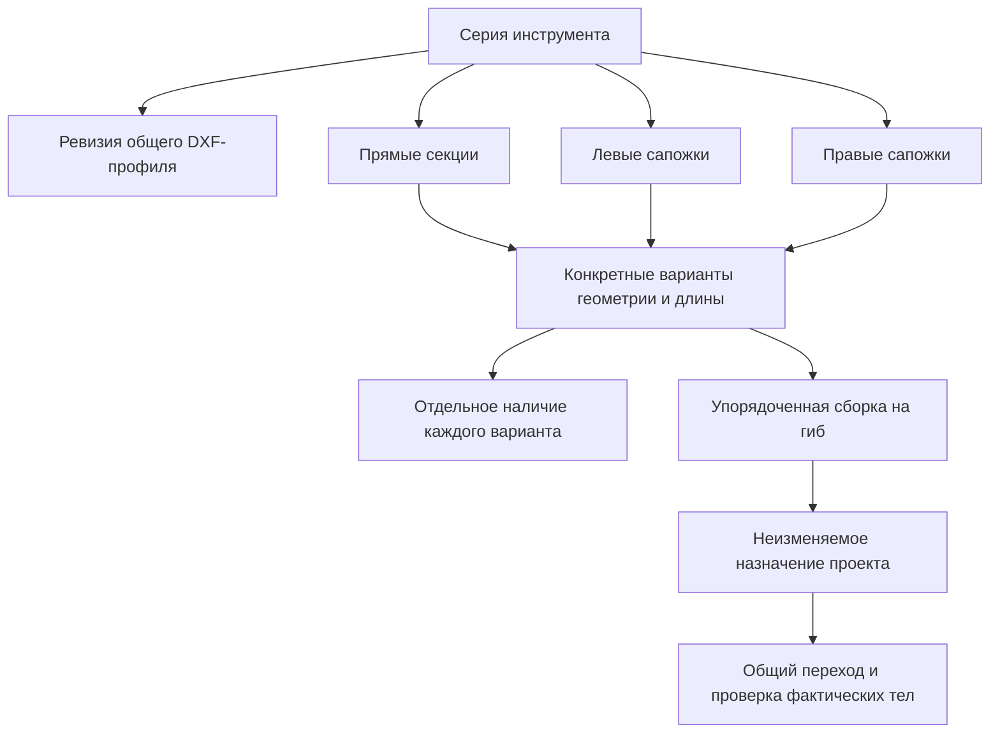

# Расширяемая архитектура библиотеки инструмента — D119

Дата: 2026-11-01. Основание: пользователь одобрил единый центр D118, потребовал различать сапожки в коллизиях/применении и продолжить проектирование расширяемой библиотеки в контексте приложения. **Статус: целевая архитектура и поэтапный переход. Первый блок D120 реализован: владелец/порт мастерской, каталог v5 с архивом и единое Qt-окно.** Остальные будущие сущности ниже поясняют целевые ответственности, а не готовый публичный API.

[Сценарий редактора и сапожки](tool-library-center.md), [текущий учёт секций](tool-segments-and-complex-parts.md), [DXF-импорт](dxf-only-tool-library.md), [постоянный кэш](tool-geometry-cache.md), [общие границы модулей](architecture.md) остаются исходными контрактами. D051/100% сохраняются.

## Что есть сейчас и где граница изменения

Уточнение D120: `application::ToolLibrary` отделён от выбора/назначения, хранит активные и удалённые пресеты. Команды записываются через `ToolLibraryStorage` и общий атомарный writer с контролем ревизии. `ToolLibraryDialog` объединяет действующие редакторы/предпросмотры. Каталог пишет v5 и читает v1–v5; `.bend` v14 и предметные ToolPreset/ToolSegment/ToolAssembly пока прежние. [Реализованный сценарий и ограничения](tool-library-center.md#реализовано-локально--d120).

`core::ToolPreset` содержит идентичность/название, один DXF-контур, рабочие параметры/ручьи и необязательные строки наличия. `ToolSegment` хранит только длину, количество и Straight/LeftHorn/RightHorn. `ToolAssembly::pieces` — индексы строк захваченного наличия; `ToolAssignment` переносит целые снимки двух пресетов, выбранный ручей/составы/ориентацию и настройки станка. Каталог D120 v5 и `.bend` v14 читаются отдельно.

Атомарный писатель находится в `project`, построение тел — в `cad`, складской planner — в чистом `core`. До D120 `ToolSelectionWidget::saveImportedTool` одновременно сохранял мастерскую, перестраивал выбор, назначал редактируемый профиль и мог менять ориентацию/состав. D120 удаляет этот обработчик: команды владельца мастерской и явное принятие выбора разделены. Ввод количества не запускает CAD/подбор.

Рабочий каталог и снимки проекта сейчас находятся в одном UI-массиве с границей `workshopSize_`. Целевая модель различает их источники явно; совпадение ID при разной геометрической ревизии не даёт права потерять захваченный снимок. Новому подбору доступны активные варианты мастерской, а не остатки чужого/старого проекта.

## Предметная модель

| Сущность | Владеет | Не определяет сама |
| --- | --- | --- |
| Серия / `ToolFamily` | Стабильный ID, вид инструмента, название/артикулы, ссылки на ревизии общего профиля и варианты секций; предпочтение обычной ориентации | Пригодность конкретной гибки и количество каждого варианта |
| Ревизия общего профиля / `ProfileRevision` | Неизменяемый численный DXF-контур в мм, происхождение/преобразования, рабочие положения ручьёв и измеренные параметры, известные геометрические базы | Наличие, положение в станке, механическая надёжность крепления |
| Вариант секции / `SectionVariant` | Собственный ID/ревизия, ссылка на точную ревизию профиля, длина, способ получения тела и особая торцевая форма; роль прямой/левой/правой секции | Складское количество и разрешение пропускать коллизии |
| Наличие / `StockEntry` | Связь с вариантом и известное количество либо явное отсутствие сведений; активность/архив | Геометрию и результат проверки детали |
| Сборка / `ToolAssembly` | Упорядоченные экземпляры конкретных вариантов, поддержанные зазоры; их положения однозначно выводятся из состава | Другую форму по названию серии, скрытую подмену секций |
| Назначение / `ToolSetupSnapshot` | Самодостаточный снимок выбранных пуансона/матрицы, ручья, сборок, фактических ориентаций и влияющих параметров установки | Живые ссылки на редактируемый каталог или положительный результат без checker |

Серия в этом первом направлении означает один подтверждённый общий рабочий профиль/крепление с вариантами длин и торцов. Просто одинаковый префикс артикула не объединяет разные R/углы/посадки. Если нужна только визуальная группа похожих, но разных профилей, её можно добавить метаданными; общий запас и общая геометрия из неё не следуют.

Это схема связей ответственности. Отдельного исходного файла/класса на каждый узел заранее не требуется. Например, метаданные и ревизия профиля могут первоначально храниться вложенными DTO с явной идентичностью. Количество не копируется в определение каждой геометрии.

### Варианты и сапожки

Для прямой секции хватает экструзии общего сечения на заданную длину. Для сапожка нужен дополнительный геометрический вход; исходное предложение — подготовленный продольный DXF сквозной торцевой выемки с базами. Область применимости такого построения ограничена и описана в D118. Другой способ построения добавляется вместе с реальным импортом, построителем и проверками; универсальный плагинный механизм или набор пустых будущих типов не нужен.

Два сапожка длиной 100 мм с разными выемками — разные варианты, с разным наличием. LeftHorn/RightHorn остаются ролью/подсказкой размещения, а не описанием тела. Зеркальность левого/правого не угадывается; явное создание зеркальной геометрии не создаёт количество. Стороны заданы в локальном базисе инструмента, а при физическом развороте пуансона вся сборка преобразуется по D089. Поворот детали остаётся независимым по D104.

У подготовленной секции кроме тела нужны подтверждённые рабочие диапазоны кромки и сведения о геометрическом креплении. Осевой габарит, рабочая длина и посадочный участок могут различаться; верхний габарит не подменяет длину контакта у сапожка. Эти сведения выводятся/проверяются по подготовленной форме; неизвестное значение явно остаётся неизвестным.

### Рабочие положения многоручьевой матрицы

Ручей — рабочее положение общего тела с собственными V/углом/радиусами и преобразованием. Он имеет стабильную идентичность внутри ревизии профиля. Порядок кнопок в интерфейсе — только представление. Все ручьи используют одно наличие физических вариантов секций; V16 и V50 одного корпуса не получают отдельные остатки.

При новой схеме старый индекс преобразуется через сохранённую таблицу именно своего снимка. Замена DXF, удаление ручья или новая сортировка не переназначает старый гиб на другой V. Новый рабочий контур, часть корпуса и монтажное положение проверяются вместе.

## Идентичность, ревизии и изменение данных

- Стабильный ID обозначает запись/вариант, а не имя, позицию в списке или хеш контура. Геометрическая ревизия неизменяема; замена DXF создаёт новую. Варианты ссылаются на конкретную ревизию, не на «последнюю»: обновление родителя не меняет их тайно.
- У workshop-снимка есть ревизия для команд редактирования/поиска. Поиск захватывает неизменяемые определения, остатки и ограничения выбора. Изменившееся наличие/каталог делает предложение неактуальным для автоматического принятия; отмена/лимит не становятся доказательством невозможности.
- Сортировка строк/смена названия не меняет физический порядок сборки. Целевой список экземпляров использует ID вариантов внутри самодостаточного снимка. Старые индексы читаются в пределах старого захваченного массива; ID появляются и сохраняются при явном переходе на новую схему, а не вычисляются каждый раз из артикула.
- Один GUI-владелец принимает команды изменения мастерской и публикует новый immutable снимок после успешной записи. Отдельный владелец DocumentSession принимает назначения/результаты проекта. Запись файла не должна незаметно вызывать «выбрать этот инструмент».
- Архив/восстановление относятся к профилям и вариантам мастерской; проекты продолжают жить со своими определениями. Удалённая запись не возвращается в активное наличие просто из-за открытия старого проекта. Явное объединение дублей проверяет совместимость и пересекающиеся остатки; автоматического суммирования нет.

| Изменение | Что обновляется | Геометрия/текущие кадры |
| --- | --- | --- |
| Имя, примечание, цвет | Представление/метаданные | Сохраняются; цвет меняет только оформление |
| Количество/архив мастерской | Доступность кандидатов и актуальность предложения | Тело не перестраивается; автономные кадры старого назначения сохраняются |
| DXF, выемка, длина, геометрические базы | Новая ревизия варианта/профиля | Новое назначение требует подготовки/проверки; старый проектный снимок остаётся прежним |
| Порядок секций, зазоры, выбранный ручей, ориентация | Новая установка проекта | Готовые локальные тела переиспользуются; актуальность перехода проверяется заново |
| STEP, толщина, материал/цели гибов | Контекст детали, развёртки/выбора/проверки | Независимые тела инструмента сохраняются в кэше; прежняя проверка другой задачи не переносится |

Отсутствие количества и нулевой остаток различаются в целевом хранении. При текущем unsigned quantity это не выполняется добавлением особого отрицательного числа. Перед переносом шаблонов нужно явно определить новую схему; `segments=null` старого файла сохраняет прежнюю семантику, пустой/нулевой явный учёт не превращается в цельный номинал.

## Возможности геометрии и пригодность к задаче

Существующий `parametersConfirmed` не нужно раздувать до единого флага «инструмент годится всегда». Внутри результата подготовки различаются: доступный контур для просмотра, поддержанное тело, распознанные рабочие контакты, геометрические монтажные базы и поддержанный отвод. Допустимая нагрузка/материальные ограничения хранятся с источником и областью применимости, если они известны; сапожок не наследует нагрузку прямой секции автоматически.

Интерфейс показывает короткий статус и причину ограничения, например «Для просмотра» или «Форма сапожка не задана». Каждый сценарий требует свой набор возможностей. Неизвестная/неподдержанная форма доступна как данные, но не получает запуск с подтверждённой геометрией и не заменяется клином.

Минимальное допустимое V и прочие ограничения текущего процесса проверяются прежними общими правилами по толщине/материалу/углу. Их нельзя продублировать внутри карточки каждой матрицы отдельными подстроенными коэффициентами. Известные ограничения станка/крепления/нагрузки — отдельные факты, доступные проверяющему сервису; совпавшее название стандарта крепления не доказывает геометрическую/механическую совместимость.

## Подбор и коллизии

Подбор имеет три уровня с общими входными снимками: допустимые рабочие профили/ручьи → доступные варианты сборки → проверяемые установки и порядок. Быстрый подбор/ручной выбор остаются доступными по D116; «Подобрать секции» фиксирует выбранные профили по D108. Ранжирование не получает право менять закреплённый технологом выбор или исключать вариант по неподтверждённой эвристике.

Сапожки становятся кандидатами с конкретной формой/положением/рабочими диапазонами. Признаки возвратных полок и ограниченного доступа помогают ранжировать их. «Коробка», «левый» или «сапожок» не являются положительной проверкой; даже правильно выбранная роль может столкнуться с соседней стенкой или держателем. Смена физического состава между операциями считается переналадкой.

CAD-builder получает всю сборку и готовит тела экземпляров/их положения. Общий checker ручного, одиночного и автоматического перехода проверяет фактические формы секций, пары крепления, деталь, узлы станка и пол по действующему охвату. AABB — ранний отсев, не замена телу выемки. Существующие контактные правила не наследуются неизвестной форме автоматически. Контактная диагностика сохраняет ID экземпляра секции для локальных накладок D099. Неуспешный безопасный префикс не выдаётся за маршрут.

Покадровая гибка, вертикальный отвод, перенос/извлечение и физика остаются разными областями доказательства. Новая секция должна пройти проверку применимости существующего способа построения занятого объёма отвода; сертификат прямой экструзии не переносится по названию серии. Сам факт угловой выемки не доказывает возможность снять замкнутую деталь с инструмента.

## Хранение и кэш

Для текущего масштаба достаточно одного ограниченного локального JSON-снимка мастерской с атомарной записью. Серии/ревизии/варианты/наличие различаются логически, но не требуют БД, отдельных файлов на каждую секцию или файлового поиска в горячем цикле planner. При реализации индексы ID → запись и группировки строятся один раз на неизменяемый снимок; строки/контуры не копируются на каждом кандидате.

Определения хранят численные захваченные контуры в мм и геометрические привязки. Путь/артикул/SHA исходного DXF служат происхождением, а не единственным источником восстановления. Работоспособность библиотеки/`.bend` не зависит от наличия файла в Загрузках. Самодостаточный проект переносит используемые ревизии/варианты/настройки; не требует доступа к мастерской и не объявляет её актуальный запас. Внешние источники не скачиваются при открытии.

Новая схема нужна вместе с первым реальным потребителем новых данных; заранее номера версий не повышаются. Чтение каталога v1–v4 и проектов v1–v14 сохраняется по их контрактам. Новые обязательные виды геометрии не записываются под старой версией; старый клиент явно отклоняет неподдержанное вместо потери выемки. Открытие не переписывает исходник; новая запись — явная команда, с проверенным восстановлением прежней версии. Архив/восстановление проектируется частью того же ограниченного снимка, с валидацией ссылок и без потерянных остатков.

Атомарная замена файла не защищает от двух одновременно редактирующих процессов. При реализации общего редактора нужны блокировка записи и сверка ожидаемой ревизии/отпечатка прочитанного файла, ошибка без скрытого перезаписывания чужой версии. Новые определения и наличие принимаются целиком после успешной записи; ошибка/отмена оставляет прежний снимок. Несколько независимых JSON-писателей из старых диалогов не сохраняются.

Производные BRep/сетки и sweep остаются в существующем D091-кэше, отдельно от первичных определений. Для нового вида тела ключ содержит фактические численные геометрические входы/базы/длину, вид и версию построителя, параметры подготовки и совместимость SDK. Имя, количество и исходный путь не меняют тело; один SHA исходного файла не подтверждает равенство после разных трансформаций/привязок. Штатная изометрия размещения использует готовое локальное тело, не новую постоянную копию на каждую деталь/поворот.

Сборка имеет отдельный производный ключ по вариантам/ревизиям/порядку/зазорам; результаты проверки — по назначению и контексту детали/операции/станка/допускам. Изменение остатка обновляет кандидатов поиска, а не геометрический кэш. Очистка/повреждение кэша ведёт к перестроению, не потере библиотеки или положительному решению без проверки. Постоянный кэш результатов переходов детали этим проектом не добавляется.

## Размещение в существующих модулях

| Модуль | Ответственность целевого блока |
| --- | --- |
| `core` | DTO определений/вариантов/наличия/сборки, их инварианты и подбор; без Qt/OCCT/путей хранения |
| `application` | Команды редактора и неизменяемые снимки мастерской/назначений, актуальность/принятие; порт хранения появляется с рабочим редактором |
| `project` | Версионный JSON, миграция чтения, атомарный writer/архив/блокировка; существующий DXF importer и дисковый artifact store |
| `cad` | Измерения/подготовка фактических тел вариантов, контакты/сборка/sweep/checker и RAM-кэш на прежнем worker |
| `ui` | Один центр с Qt Model/View, ввод/предпросмотр/короткие причины; быстрый picker и выбор детали используют те же снимки |
| `viewer` | Готовые изображения/тела/накладки; без построения геометрии и предметных решений |
| `app` | Создание и соединение конкретных владельцев/хранилищ/сервисов |

Нового модуля, общей CAD-иерархии, DI-фреймворка, SQL-зависимости и публичного plugin API сейчас не требуется. Новые интерфейсы вводятся при выделении реального потребителя, в рамках прежних направлений CMake. Команды импорта/подготовки используют прежний CAD-worker, отмену и ID/ревизии; второй параллельный поток OCCT для редактора не вводится.

## Порядок реализации и приёмка

1. **Разделить изменение мастерской и назначение.** Единый владелец/команды, явный результат записи и адресные уведомления. Изменение названия/остатка не выбирает другой инструмент, не поворачивает пуансон и не запускает CAD. Фоновый ответ старой ревизии не принимается. Существующие выбор/подбор/сохранение остаются рабочими.
2. **Собрать единый центр D118.** Профиль, длины/количества, импорт/замена, удаление/устойчивое восстановление; быстрый picker сохранён. Стабильные ссылки, состояние неизвестного наличия и новая схема появляются вместе с действительно использующими их операциями. Миграция/проектные снимки/ошибки записи проверяются до включения новых правок пользователю.
3. **Реализовать первый реальный вариант сапожка.** Подготовленный дополнительный DXF, ограниченный построитель, рабочие диапазоны/посадка, обе стороны/ориентации и кэш. Прямая сталкивается — подходящий сапожок проходит; неправильный всё ещё сталкивается. До этого рожки остаются учётными данными без включения в расчёт.
4. **Расширить совместный подбор сборок и порядка.** Разные реальные варианты/составы, ограниченные кандидаты/кэши, ранжирование доступа; общий checker и фиксированный выбор технолога сохранены. Измерить время до первого решения, число точных переходов и попадания кэша; не прореживать кадры ради ускорения.

Регрессии дополняют D118: сортировка/удаление не портят старую сборку; два экземпляра одной длины с разными выемками различаются; V одного корпуса делят остаток; два процесса не теряют изменения; переименование/цвет не строят тело; повреждённый кэш восстанавливается; автономный проект открывается без мастерской; неподдержанный/ограниченный поиск не объявляет изготовление невозможным. Перед реализацией выполнять подходящие core/dev/native-100% проверки по `development.md`; документация сама по себе не подтверждает новые функции Qt/Windows.
